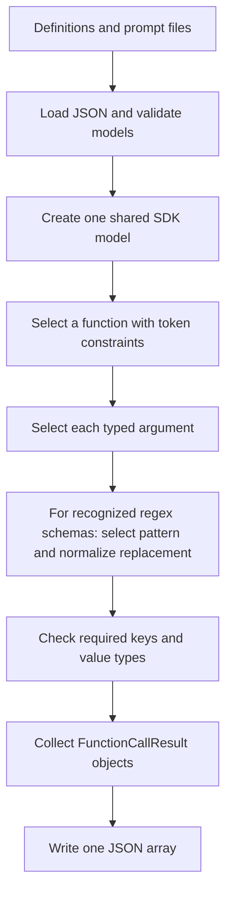

*This project has been created as part of the 42 curriculum by cerkurt.*

# call_me_maybe

A local function-calling tool that translates natural-language requests into
function names and typed arguments using a small language model and
token-by-token constrained decoding.

## Contents

- [Description](#description)
- [Instructions](#instructions)
- [Input and output formats](#input-and-output-formats)
- [Project structure](#project-structure)
- [Algorithm explanation](#algorithm-explanation)
- [Design decisions](#design-decisions)
- [Challenges encountered](#challenges-encountered)
- [Testing strategy](#testing-strategy)
- [Performance analysis](#performance-analysis)
- [Current limitations and remaining work](#current-limitations-and-remaining-work)
- [Resources and AI usage](#resources-and-ai-usage)

## Description

Given a request such as `What is the sum of 40 and 2?`, the program identifies
the appropriate function and extracts its input arguments. The result is a
structured call:

```json
[
    {
        "prompt": "What is the sum of 40 and 2?",
        "name": "fn_add_numbers",
        "parameters": {
            "a": 40.0,
            "b": 2.0
        }
    }
]
```

The output describes the call; the application does not execute the selected
function or calculate its return value.

Function definitions are supplied through JSON files. Their names,
descriptions, parameter names, and declared types drive the selection and
validation process. The current supported parameter and return type
declarations are `number`, `string`, and `boolean`.

The supplied `Small_LLM_Model` SDK loads `Qwen/Qwen3-0.6B` by default.
The application uses its public encoding, decoding, and logit methods.
At each generation step, invalid candidate continuations are masked before
the next token is selected.

**Development snapshot — November 16, 2026:** argument extraction now uses
one shared, type-aware prompt builder. The string candidate pool includes
quoted values, individual words, two- and three-word phrases, and the full
request. Regex arguments have a separate constrained category-selection
step. Current measurements and remaining semantic errors are recorded under
[Testing strategy](#testing-strategy); passing schema checks alone does not
establish that a call has the intended meaning.

## Instructions

### Requirements and installation

- Python 3.10 or newer, as declared in `pyproject.toml`.
- [uv](https://docs.astral.sh/uv/getting-started/installation/).
- The supplied `llm_sdk` workspace directory.
- Internet access for the initial dependency and model downloads.

The recorded local checks used Python **3.14.4** on macOS.

Run these commands from the repository root, alongside `pyproject.toml`:

```bash
uv sync
mkdir -p data/output
```

The first model initialization downloads model and tokenizer files.
Subsequent runs can reuse the local model cache. Download time is separate
from the cached-model performance measurement below.

The outer `llm_sdk` directory is a uv workspace package. Its inner
`llm_sdk` directory is the Python import package. Once uv installs the
workspace, the public import is:

```python
from llm_sdk import Small_LLM_Model
```

### Default execution

```bash
uv run python -m src
```

Default paths:

| CLI option | Default |
|---|---|
| `--functions_definition` | `data/input/functions_definition.json` |
| `--input` | `data/input/function_calling_tests.json` |
| `--output` | `data/output/function_calling_results.json` |

The output directory must exist. The writer opens the selected output file
in write mode, replacing its previous contents after generation succeeds.

### Custom paths and example usage

Run the additional test set:

```bash
uv run python -m src \
    --functions_definition ../test_inputs/mandatory_functions.json \
    --input ../test_inputs/mandatory_prompts.json \
    --output data/output/mandatory_results.json
```

Despite their development names, these `mandatory_*` files are a local test
set assembled during implementation, not an official evaluation dataset.
In the current workspace, `test_inputs/` is beside `project_repo/`, one
directory above the repository root. These local fixtures are not a
guaranteed part of a fresh clone; supply your own files or use the default
files in `data/input/` if they are unavailable.

Display CLI help:

```bash
uv run python -m src --help
```

Inspect a generated file:

```bash
uv run python -m json.tool data/output/mandatory_results.json
```

Parsing a file is one check. Required keys, declared types, and the intended
argument values also need verification.

### Error handling

The CLI reports input-file errors, malformed JSON, Pydantic validation
failures, candidate-generation errors, and output-file errors. Handled
failures exit with status `1`; successful runs exit with status `0`.

Examples include:

- A missing definitions or prompts file.
- A JSON root that is not a list.
- A list member that is not a dictionary.
- A missing required model field.
- No allowed candidate continuation.
- An exhausted generation token budget.
- A numeric conversion that produces infinity, or a non-finite output value.
- An unavailable output directory or an output path that is a directory.

Input loading and generation finish before the output writer is called.
The writer also serializes the complete result before opening the file.
A failure before writing, including a JSON conversion error, leaves an
existing output file in place.
Check the command's exit status when evaluating a run.

### Code-quality checks

```bash
uv run mypy .
uv run --with flake8 flake8 .
```

Mypy is declared in the development dependencies. The `--with flake8` form
makes flake8 available for that invocation without requiring a global
installation. Both tools exclude the supplied SDK implementation through
the repository configuration.

## Input and output formats

### Function definitions

The definitions file contains a JSON array. Each item describes one function:

```json
[
    {
        "name": "fn_add_numbers",
        "description": "Add two numbers together and return their sum.",
        "parameters": {
            "a": {
                "type": "number"
            },
            "b": {
                "type": "number"
            }
        },
        "returns": {
            "type": "number"
        }
    }
]
```

A declared return type describes the available function. It is not a result
the application needs to compute.

Pydantic converts these dictionaries into `FunctionDefinition` objects
containing nested `ParameterDefinition` and `ReturnDefinition` objects.

### Prompt tests

The prompts file contains an array of requests:

```json
[
    {
        "prompt": "What is the sum of 40 and 2?"
    }
]
```

Each item is validated as a `PromptTest`.

### Results

Each request produces one `FunctionCallResult` with exactly these output
fields:

| Field | Meaning |
|---|---|
| `prompt` | The original request text. |
| `name` | The selected function name. |
| `parameters` | The complete dictionary of extracted argument values. |

Numbers and booleans are JSON values rather than quoted type names:

```json
{
    "prompt": "Disable notifications for room 'kitchen'.",
    "name": "set_notifications",
    "parameters": {
        "room": "kitchen",
        "enabled": false
    }
}
```

Both `7` and `7.0` satisfy the declared `number` type. The current numeric
extractor converts matching text into Python floats.

## Project structure

```text
.
├── pyproject.toml
├── uv.lock
├── .flake8
├── src/
│   ├── __main__.py       # CLI and application orchestration
│   ├── data_models.py    # Pydantic models and result-key/type checks
│   ├── data_io.py        # JSON loading, model validation, result writing
│   └── generators.py     # Prompts, candidate extraction and token selection
├── data/
│   ├── input/           # Definitions and request sets
│   └── output/          # Generated result arrays
├── llm_sdk/             # Supplied uv workspace package
│   └── llm_sdk/
│       └── __init__.py
└── sdk_playground.py    # Manually selected SDK/decoding experiments
```

The CLI imports the reusable `src` modules. Playground experiments remain
outside the production entry point.
The local extended fixtures are currently in `../test_inputs/`, outside
this repository. The earlier `test_validate.py` scratch file has been
removed from the working tree.

## Algorithm explanation

### End-to-end flow



`progress_builder()` manages the request loop. Function-name encodings are
prepared once for the supplied definitions. Each request receives its own
parameter dictionary; one result is collected after all its parameters
have been extracted and checked.

### 1. Format the model input

Selection prompts contain the available names and descriptions, followed by
the actual request. They are wrapped in system and user messages, then an
open assistant response.

The current assistant prefix is:

```text
<|im_start|>assistant
<think>

</think>

```

The closing user-message marker is present; the assistant response remains
open for generation. These role and generation markers follow the
model-specific chat format discussed in the
[chat-template documentation](https://huggingface.co/docs/transformers/main/en/chat_templating).

The SDK returns an encoded tensor with a batch dimension, such as shape
`(1, N)`. Selecting `[0]` and calling `.tolist()` provides the flat token-ID
list expected by `get_logits_from_input_ids()`.

Two token histories have different responsibilities:

- `all_token_ids` contains the prompt and generated continuation, providing
  context to the model.
- `generated_token_ids` contains only the continuation, providing the prefix
  used for candidate matching.

### 2. Find allowed next token IDs

Each candidate function name is encoded into a token-ID sequence.
A candidate remains possible when its initial IDs match the entire
generated prefix.

For illustration, assume these invented IDs:

```text
function_a → [10, 20]
function_b → [10, 30]
```

| Generated prefix | Allowed next IDs |
|---|---|
| `[]` | `{10}` |
| `[10]` | `{20, 30}` |
| `[10, 20]` | Completed candidate: `function_a` |

The next position is the length of the generated prefix. Completion is
checked against the whole candidate sequence, including after the final
permitted generation step.

This is implemented by `find_allowed_next_token_ids()` and
`generate_name_from_candidates()`. The latter is also reused for argument
candidates despite its original function-name-oriented name.

### 3. Mask logits and select a token

The model returns a logit for each output-vocabulary position. A logit is a
raw next-token score; it is not a token ID or a normalized probability.

`select_next_token_id()` replaces disallowed scores with negative infinity
while preserving every position in the vector. It then selects the index
of the largest remaining score.

```text
Original logits: [9.0, 7.0, 5.0]
Allowed IDs:     [1, 2]
Masked logits:   [-inf, 7.0, 5.0]
Selected ID:     1
```

Keeping positions intact matters: compressing the vector to `[7.0, 5.0]`
would make index `0` refer to a different token.

The chosen ID is appended to both histories. Allowed continuations are
recomputed at the next step.

### 4. Build typed argument candidates and one shared extraction prompt

The production pipeline currently uses a finite set of possible values:

| Declared type | Candidate construction |
|---|---|
| `number` | Extract signed integers, decimals including `.5`, scientific notation such as `1e3`, and comma-grouped forms such as `1,000`; remove grouping commas and convert to finite floats. |
| `string` | Keep individual fragments, quoted contents, two- and three-word phrases outside quotes, and the full request; deduplicate while preserving order. |
| `boolean` | Offer the actual Python values `True` and `False`. |

Each value is serialized with `json.dumps()` and encoded for constrained
selection. The current representation puts a leading space before that
serialized value.

`message_for_parameter_extraction()` replaces the earlier
`message_for_number_parameter()` and separate string-message path. All
ordinary parameter types share its message assembly and JSON prefix.
For a string parameter, the system instruction asks for the complete input
value, preservation of spelling and formatting, and separation of the
requested action from its argument. Number and boolean parameters use the
general argument-extraction instruction. Boolean requests also include a
question about the meaning of the current parameter name.

The current shared builder does not require a separate few-shot string
example. An older `message_for_string_parameter()` implementation remains
commented out as development history; it is not part of CLI generation.

The request, selected function, all parameter declarations, current parameter
name, and arguments already extracted are included in the model input.
An open JSON-object prefix supplies context for the next value, for example:

```text
{"a": 2.0, "b":
```

The returned candidate is decoded as a Python value with `json.loads()`,
then stored under the current parameter name.

The candidate list can contain the same numeric value for different
arguments. Repeated arguments such as `a=7` and `b=7` are valid.

The n-gram step means contiguous groups of **two or three words**, not model
tokens. For `Greet Ceren Kurt`, the pool includes `Ceren`, `Kurt`,
`Greet Ceren`, `Ceren Kurt`, and the complete request. For
`Echo the text Good morning everyone`, it also contains
`Good morning everyone`. Quoted spans are preserved separately rather than
being split into n-grams. Keeping several candidates makes the correct
value available; the model still has to choose it correctly.

The former single-parameter/single-quote shortcut was removed. In
`Greet Ceren Kurt using the word 'hello'`, the presence of `hello` therefore
does not remove `Ceren Kurt` from the pool. This is a bounded candidate
strategy: arbitrary unquoted phrases of four or more words are not all
enumerated.

### 5. Handle recognized regex arguments

`progress_builder()` recognizes a regex schema when it contains
`source_string`, `regex`, and `replacement`, all declared as `string`.
This check is based on parameter names and types, not a hardcoded function
name. It does not recognize every possible naming convention for regex
functions.

For such a schema, the ordinary parameter loop skips `regex` and first
extracts the source text and replacement. After those values are available:

1. `convert_regex_replacement_value()` handles supported unquoted character
   names following `with`, such as `asterisks` becoming `*`. Quoted
   `'asterisks'` remains literal text. The current names cover asterisk,
   hyphen, and underscore, including their plural forms.
2. `regex_candidate_generator()` builds seven category patterns: vowels,
   letters, digit sequences, uppercase letters, lowercase letters,
   whitespace, and punctuation. It also adds eligible quoted literals from
   the request using `re.escape()`.
3. `generate_regex_pattern()` presents category descriptions with short
   option codes such as `A`, `B`, and `C`. It encodes the codes and uses the
   same prefix constraints and logit masking to select an allowed code.
4. The code is mapped back to its label and then to the actual regex.

For example, the selected vowel category maps to `[aeiouAEIOU]`, while
digit sequences map to `[0-9]+`. Literal `cat` maps to an escaped literal
pattern. The final dictionary stores the pattern, not its option code.

This is finite-category selection with request-derived literals, not
unrestricted regex synthesis. `re.sub()` is used in playground checks to
verify behavior; the production application outputs the call without
executing the requested function.

### 6. Validate and serialize the result

`parameter_type_checker()` checks missing and unexpected parameter names,
then verifies the value associated with each declared name:

- `number` accepts `int` or finite `float` values and explicitly rejects
  `bool`. Infinity and NaN are rejected.
- `string` accepts `str`.
- `boolean` accepts `bool`.

The explicit boolean exclusion matters because Python considers booleans
instances of `int`.

`FunctionCallResult.parameters` is typed as `dict[str, object]`.
The additional checker supplies the function-specific checks that this
broad model field cannot provide alone.

Finally, `model_dump()` converts the result models to dictionaries and
`json.dumps(..., allow_nan=False)` prepares the complete JSON text. The
writer opens the output file only after serialization succeeds, then writes
that text with the file's `write()` method. Serializing this text again
would turn the root into a JSON string instead of the required array.

The number extractor rejects non-finite float conversions before candidate
encoding; the parameter checker independently checks generated values.
Strict serialization provides a final check when the writer is called
directly. This prevents `Infinity`, `-Infinity`, and `NaN` constants, which
are excluded by [RFC 8259](https://www.rfc-editor.org/rfc/rfc8259#section-6).
The CLI reports serialization errors with status `1`.

The token mask constrains candidate membership. Candidate construction,
type checking, serialization, and semantic accuracy remain separate
responsibilities; see the known limitations below.

### Experimental JSON-string decoder

`generators.py` also contains `get_json_string_state()`,
`find_allowed_string_token_ids()`, and `generate_json_string()`.
These experiments examine string prefixes using states including
`not_started`, `in_string`, `backslash`, `unicode`, `completed`, and `invalid`.

They were used to explore quotes, escaped characters, and Unicode escapes.
The main CLI currently uses the finite-candidate argument path described
above. The experimental string decoder is not a general JSON-schema engine
integrated into that path.

## Design decisions

- **Separate I/O, data models, generation, and orchestration.** Loading a file
  and selecting a model continuation have different responsibilities.
  Reusable functions receive paths, validated objects, or an existing SDK
  model as appropriate.
- **Reuse one model instance.** Model loading happens once after the input
  files have been validated.
- **Read function metadata from the supplied definitions.** The selection
  pipeline does not contain a branch for each sample function name.
- **Use explicit candidate constraints.** Prompt wording provides context;
  the logit mask restricts which candidate continuations can be selected.
- **Retain extraction context.** Previously extracted parameters accompany
  the current parameter request.
- **Share prompt assembly across parameter types.** A type-specific system
  instruction is selected inside one builder, while function metadata,
  previous values, chat roles, and the open JSON prefix use one structure.
- **Expand the pool before constraining selection.** Word n-grams make
  multiword values available without assuming every quoted phrase is the
  desired argument. The token mask then restricts selection to that pool.
- **Accumulate one complete result per request.** Parameter dictionaries
  are initialized outside the inner parameter loop.
- **Report errors at the CLI boundary.** Lower-level loading and validation
  functions propagate errors; handled failures terminate the command.
- **Keep an observable experimental path.** The playground contains
  individual experiments used to understand the SDK before integrating
  reusable logic into `src`.

## Challenges encountered

### Whitespace changes token boundaries and model scores

A leading or trailing space is part of the token sequence. During development,
moving a space between the JSON prefix and the value candidate changed the
IDs presented to the model and the allowed next-token choices.

For example, the following were measured through the SDK tokenizer:

| Text supplied to `encode()` | IDs |
|---|---|
| A single space | `[220]` |
| A double quote | `[1]` |
| A space followed by a double quote | `[330]` |
| `"cat"` | `[1, 4616, 1]` |
| A space followed by `"cat"` | `[330, 4616, 1]` |
| `"cat"` followed by a space | `[1, 4616, 1, 220]` |
| A minus sign | `[12]` |
| A space followed by a minus sign | `[481]` |

These IDs describe the inspected tokenizer, not a universal vocabulary.

Consider two ways to construct the same visible boundary:

```text
A: encode(prefix ending in ": ") + encode("\"cat\"")
B: encode(prefix ending in ":")  + encode(" \"cat\"")
```

The concatenated text can look identical while the concatenated token-ID
lists differ. In general:

```text
encode(prefix) + encode(value) != encode(prefix + value)
```

In case A, a separate space and quote can produce IDs `220` and `1`.
In case B, the combined space-plus-quote token can be `330`.
The model is then evaluating different token continuations at different
positions, so the logits are not directly interchangeable.

Trailing whitespace cannot retroactively change logits that have already
been computed. It can affect tokenization at a boundary, the allowed
continuations, or when a candidate is considered complete. Investigating
a changed answer requires the exact prompt and candidate token sequences.

Whitespace also has a data-level meaning:

| JSON text | Decoded value |
|---|---|
| `"cat"` | Three characters: `cat` |
| `"cat" ` | The same three-character value; the space is outside the string. |
| `"cat "` | Four characters; the final space belongs to the argument. |

The current argument path ends the JSON prefix at the colon and puts the
space at the beginning of the serialized candidate. This convention improved
the tested boundaries together with the fuller argument context. It is not
a universal rule that adding a space produces the correct semantic answer.

### A correct value must be present in the candidate pool

One request exposed a candidate-extraction error:

```text
Set the temperature to 18 degrees for room 'office'.
```

The outside-quotes splitter retained `'office'.`. Its final character was
a period, so the condition that removed matching outer quotes did not apply.
The plain `office` value was absent from the pool, making it unavailable
to constrained selection.

The inside-quotes helper already found `office`. Its results were added
to the candidate pool for multi-parameter functions, which fixed the
temperature example.

This led to a useful debugging order: inspect candidate construction before
changing the model prompt.

### Multiword values needed both a larger pool and clearer instructions

An earlier pool could offer only separate words for an unquoted full name.
For `Greet Ceren Kurt`, selecting either `Ceren` or `Kurt` loses part of
the requested value. Adding contiguous two- and three-word phrases makes
`Ceren Kurt` available without manually encoding a specific person's name.

Pool construction and prompting solve different parts of this problem.
The shared builder's string instruction asks for the complete current
argument and distinguishes it from the command. In
`Greet Ceren Kurt using the word 'hello'`, both the name and the quoted
word remain candidates; the function description and parameter name must
guide the model to the name. The saved 35-request fixture correctly
extracts all nine greet examples and the six echo examples, including
an unquoted three-word value, an empty string, and Unicode.

The implementation deduplicates candidates after adding words, phrases,
quoted spans, and the full request. It does not enumerate every possible
substring. A targeted pool check still finds no
`First Second Third Fourth` candidate for the longer command
`Greet First Second Third Fourth`.

### Valid JSON regexes could still match the wrong characters

The experimental free-string path could produce a complete JSON string
whose content was the wrong regex. For example, `[a-zA-Z]+` is a valid
pattern but replaces whole letter sequences when the request asks only
for vowels. Testing only `json.loads()` would miss that error.

Playground checks therefore applied the selected pattern to source text:

| Source | Pattern | Replacement | Expected diagnostic result |
|---|---|---|---|
| `Room 12` | `[0-9]+` | `X` | `Room X` |
| `Programming is fun` | `[aeiouAEIOU]` | `*` | `Pr*gr*mm*ng *s f*n` |
| `The cat sat on the mat with another cat` | `cat` | `dog` | `The dog sat on the mat with another dog` |

Selecting short option codes from a described pattern catalog gave a
usable bounded path. The code, descriptive label, regex text, and encoded
token sequence have separate roles. Encoding the option codes constrains
the model's answer to the displayed choices; mapping back supplies the
actual pattern. Prompt wording still affects which allowed option wins.
The catalog is therefore documented as limited support, rather than a
guarantee of arbitrary regex generation.

The literal replacement `asterisks` exposed a separate issue: even the
correct vowel pattern inserts that word repeatedly unless the requested
symbol is interpreted as `*`. The small quote-aware character-name helper
addresses the supported cases while preserving quoted literal text.

### Numeric parsing improvements do not guarantee the chosen argument

The old numeric pattern split `.5`, scientific notation, and comma-grouped
numbers incorrectly. The updated extractor offers `0.5`, `1000.0`, and
`1000.0` for `.5`, `1e3`, and `1,000`, respectively. A saved output file can
still contain results from before the parser changed, so it must be
distinguished from a fresh CLI run.

For `Add 0.5 and -0.5.`, the current helper returns both signed values.
If the model selects `0.5` for both parameters, the remaining error is in
semantic selection, not a missing minus sign in the candidate pool. A fix
must preserve valid repetitions such as `Add 7 and 7`; globally banning
already-selected values would break that case.

### Quoted text, apostrophes, and escape characters have different roles

`Reverse 'hello world' please` contains one quoted argument with an internal
space. Splitting only on spaces loses that grouping.

There are also multiple interpretation layers:

1. A Python source string may process escape sequences before a function
   receives it.
2. A JSON input file has its own string-escaping rules.
3. A quote in the natural-language request can delimit an argument or be
   part of its content.
4. The output serializer must escape the resulting value correctly.

For example:

```python
actual_newline = "\n"
escaped_newline = "\\n"

assert len(actual_newline) == 1
assert len(escaped_newline) == 2
```

A literal newline inside a JSON string must be escaped. In the string-state
experiments, a backslash followed by the letter `n` is handled differently
from a raw control character. Inspecting `repr(text)` helped make the
difference visible.

The current splitters handle the tested quote forms; escaped delimiters
and more ambiguous natural-language quoting still need broader coverage.

### Schema validity and the intended meaning need different tests

A value can have the correct type and still represent the wrong argument.

During an early `Reverse the string 'hello'` experiment, the next-token
scores after the opening quote were approximately:

| Candidate token | Logit |
|---|---:|
| `string` | 25.0326 |
| `hello` | 25.0196 |

Both were allowed strings. Greedy selection picked `string` by a small
margin. In the corresponding `world` request, `world` scored about 28.3006
and `string` about 26.6283.

Restricting a quoted single-argument request to its quoted candidate helped
those examples, but excluded the actual name in requests such as
`Greet Ceren using the word 'hello'`. The current implementation removed
that shortcut, expanded the pool with n-grams, and strengthened the shared
string instruction. Quoted text remains available alongside other values.

The same distinction applies to booleans: `disabled: true` is validly
typed but wrong for a request to enable notifications.

### An extra function exposed weak selection prompting

With only temperature and notification functions, the small test set selected
the expected names. After `echo_text` was added, the plain selection prompt
chose `echo_text` for all nine requests.

Wrapping the same selection content in system and user messages followed
by an open assistant prefix restored correct name selection in a diagnostic
covering nine new requests and eleven original requests.

The production function was then updated, and the complete additional
test set was checked again. This was a prompt-format improvement; the
token mask continued to enforce the available name candidates.

### Extracted arguments must remain separate from parameter declarations

The metadata `{"type": "number"}` describes what kind of value a parameter
expects. An extracted value such as `2.0` is a separate piece of data.

Similarly, printing `ParameterDefinition(type='number')` displays a nested
Pydantic object's representation. The object has not become a string field.
Its `.type` attribute accesses the declared type, and `model_dump()` creates
a dictionary representation.

Keeping those layers distinct prevented mistakes such as treating the
parameter dictionary as a single parameter name or replacing a function
definition's metadata with the extracted arguments.

The word "model" also names two different concepts here: Pydantic models
validate structured data, while `Small_LLM_Model` supplies tokenizer
operations and next-token scores. Each function needs the appropriate kind
of object for its responsibility.

### Loop placement and mutation affected the whole output

Several implementation details had visible consequences:

- Printing a header inside a parameter loop repeated the header.
- Returning from inside the first generation iteration stopped generation
  after one token.
- Creating a result inside the parameter loop produced separate result
  objects for `a` and `b`.
- `list.append()` modifies the existing list and returns `None`.
- Both token histories must receive each selected ID, while candidate
  matching uses only the generated prefix.

The final structure collects all parameters before appending one result
for a request.

### A tuple of messages is not one model-input string

This return value contains three separate strings in a tuple:

```python
return system_message, user_message, open_assistant_start
```

The SDK expects one input string. Passing the tuple during development
produced a tensor-shape error referring to inconsistent sequence lengths.
Concatenating the message strings before returning them fixed the mismatch.

A `-> str` annotation describes the intended contract; it does not convert
an incorrect return value at runtime. Mypy provides an earlier check of
that contract.

### Unicode escapes can preserve the original text

This JSON representation:

```json
{
    "text": "\u00c7a\u011fr\u0131 \ud83c\udf21\ufe0f"
}
```

decodes to:

```text
Çağrı 🌡️
```

The verified comparison used `json.load()`/`json.loads()` and the actual
decoded value. Python's JSON writer uses ASCII escaping by default.
The current writer uses `ensure_ascii=False` and UTF-8 so literal Unicode
characters remain readable in the file. This changes presentation rather
than the decoded value.
See the [Python JSON documentation](https://docs.python.org/3/library/json.html).

### Exceptions belong at the right boundary

A missing file already raises an error from `open()`. A malformed JSON
document raises a decoding error from `json.load()`. A mismatched Pydantic
field raises a validation error.

A lower-level `except` block that only re-raises the same error adds no
new handling. The CLI provides context and an exit status for handled
failures. Stopping after a failed generation also avoids continuing with
a result variable that was never assigned.

## Testing strategy

Testing covers separate questions:

| Layer | Check |
|---|---|
| Loading | Files exist, JSON parses, roots are arrays, items are dictionaries. |
| Model validation | Required function and prompt fields can be constructed. |
| Candidate construction | Expected argument values occur in the pool. |
| Token constraints | Allowed next IDs preserve a candidate prefix; score indexes remain token IDs. |
| Output schema | Original prompt, valid name, required argument keys, correct value types. |
| Meaning | Selected values match an independently specified expected call. |
| Integration | The real CLI reads selected paths and writes one result per request. |
| Performance | Measure the whole cached-model CLI run separately from downloads. |

### Reproducing the additional test set

Run the custom-path command in the Instructions section, then compare the
output with these representative expectations:

| Request | Expected selection |
|---|---|
| `Set room 'living room' to -5.5 degrees.` | `set_temperature` with `room="living room"`, `degrees=-5.5` |
| `Set the temperature to 18 degrees for room 'office'.` | `set_temperature` with `room="office"`, `degrees=18` |
| `Disable notifications for room 'kitchen'.` | `set_notifications` with `enabled=false` |
| `Echo ''` | `echo_text` with an empty `text` string |
| `Echo 'She said "hello"'` | `echo_text` preserving the inner double quotes |
| `Echo 'Çağrı 🌡️'` | `echo_text` preserving the decoded Unicode value |
| `Add 7 and 7.` | `fn_add_numbers` with both values equal to `7` |
| `Add 123456789 and 2.` | `fn_add_numbers` with `123456789` and `2` |
| `Greet Ceren Kurt` | `fn_greet` with `name="Ceren Kurt"` |
| `Greet Ceren Kurt using the word 'hello'` | `fn_greet` with `name="Ceren Kurt"`, retaining the unrelated quoted word as another candidate |
| `Echo the text Good morning everyone` | `echo_text` with `text="Good morning everyone"` |

As of November 16, this fixture contains six function definitions and
35 requests. It also includes zero, scientific notation, comma-grouped
numbers, leading-dot decimals, negation, and quoted/unquoted full names.
Expected values are specified independently of the generated output.

### Manual development tools

```bash
uv run python -m sdk_playground
```

`sdk_playground.py` contains individual experiments; inspect the call at
the bottom to select the active experiment. Some intentionally exercise error cases and raise
exceptions. This file is not a complete automated test suite. Some older
experiments still pass the removed second argument to `string_slicer()` or
refer to the former fixture locations; update those calls before running
them. The current production signature is `string_slicer(user_request)`.

A module name passed to `python -m` has no `.py` suffix.

### Recorded results

Fresh checks on November 16, 2026:

| Check | Result | Scope |
|---|---:|---|
| Saved `extended_test_results.json` | 28/35 complete calls; 34/35 names | Earlier saved output; not the result of the latest numeric extractor. |
| Current extended fixture, real CLI | 33/35 complete calls; 34/35 names | Six definitions, 35 requests; 89.231 seconds; exit status 0. |
| Current original fixture, real CLI | 10/11 complete calls; 11/11 names | All three regex calls pass; `Greet shrek` incorrectly includes the command in its argument. |
| Combined current CLI results | 43/46 complete calls (93.5%); 45/46 names | Known development fixtures, not unseen evaluation data. All 46 results pass strict JSON, original-prompt, key, and declared-type checks. |
| Numeric helper, direct checks | 10/10 expected lists | Includes `.5`, `-.5`, `1e3`, `1,000`, `1,234,567.89`, `2E-3`, and positive/negative pairs. |
| String-pool checks | Four expected candidates present; one limit confirmed | Full name, unrelated quoted word, unquoted three-word value, and empty string retained; an internal four-word value is absent. |
| Mypy / flake8 | 9 errors / 5 violations | Refactoring and playground cleanup remain open. |

Three complete-call errors remain in these two fresh CLI runs:

- `Do not enable notifications for room 'office'.` selects `fn_greet`
  instead of the notification function. The test expectation interprets
  this request as `enabled=false`; it requires no function execution.
- `Add 0.5 and -0.5.` returns positive `0.5` for both parameters, although
  both signed candidates are available.
- `Greet shrek` selects the correct function but returns `"Greet shrek"`
  instead of `"shrek"`. This is a regression from the earlier passing set.

Both CLI runs used the real SDK with cached model files and downloads
disabled, and wrote to isolated temporary output paths. The supplied saved
output was left unchanged. Direct helper checks did not run model inference.
The extended fixture has correct results for all nine greet examples and
all six echo examples, including full names, Unicode, apostrophes, and empty
text. Those successes do not cover every name or quoting form.

Historical checkpoints, retained to distinguish earlier versions:

| Check | Result | Scope |
|---|---:|---|
| November 12 additional test set | 11/11 complete calls | Earlier four-definition fixture. |
| November 12 original test set | 9/11 complete calls | All 11 names correct; two regex argument extractions incorrect. |
| November 15 original and additional sets | 22/22 complete calls | Two 11-request fixtures; cached-model CLI times 37.456 and 35.147 seconds. |
| Chat-format selection diagnostic | 20/20 function names | Name selection only, across two request sets. |
| CLI success/error scenarios | 12/12 expected outcomes | Earlier integration checks, including controlled model/generation failures. |
| Number-value validation | 8/8 expected outcomes | Finite values, large integers, infinity, NaN, and boolean rejection in a number field. |
| Strict result writing | 6/6 expected outcomes | Array round trip, non-finite rejection, preserved existing files, and no new file for invalid data. |
| CLI output-error handling | 2/2 expected outcomes | Real writer and CLI handlers; controlled generation supplied invalid data or an unavailable destination. |
| Boolean polarity comparison | 3/4 correct values | Both `enabled` cases pass; `disabled` with `Enable notifications` remains incorrect. |

The CLI scenario checks include custom paths, malformed and missing input,
invalid list members, missing fields, output path failures, and controlled
initialization/generation errors.

The two output-error checks stubbed model construction and generation to
reach the output boundary directly. Loading, serialization, file handling,
and CLI exception handling remained real. The separate 11-request run used
the real SDK model throughout.

These measurements describe specific test sets. Unseen functions and
requests still require independent evaluation against the subject's
90%+ accuracy target.

## Performance analysis

The November 16 full CLI run of the expanded **35-request** fixture took
**89.231 seconds**, including startup and model loading. It returned
33 completely correct calls, 34 correct function names, and 35
schema-compliant results. Speed and semantic accuracy are separate checks.

Measurement conditions:

- macOS, Python 3.14.4.
- The SDK's default model and automatic device selection.
- Model files already cached; model downloads disabled.
- The project virtual-environment interpreter ran `python -m src`.
- Time included application startup, model initialization, generation,
  validation, and output writing.
- The process exited with status `0` and wrote 35 results to an isolated
  temporary path, then each call was compared with an explicit expectation.

This measured run is below the subject's five-minute limit for that
machine and workload. First-time downloads, different hardware, longer
requests, and larger function sets can change the elapsed time.

The implementation avoids repeatedly constructing the model and prepares
the function-name encodings once per run. Each token step still requests
logits for the complete current context through the SDK, scans candidate
prefixes, and masks the vocabulary scores. Long contexts and continuations
therefore remain relevant performance factors.

## Current limitations and remaining work

1. **Candidate coverage is bounded.** Ordinary arguments are selected from
   the constructed pool. Two- and three-word n-grams improve unquoted
   multiword extraction, but a four-word argument inside a longer unquoted
   command may still be absent. Quoted spans and the entire original
   request are retained separately. Prompt instructions cannot recover an
   absent candidate.
2. **Regex support has a finite scope.** The specialized branch requires
   the three canonical string parameter names. Its seven categories and
   request-derived literals do not cover arbitrary regexes. Whole-source
   literals are excluded by the current literal filter. Replacement-name
   conversion only covers the registered asterisk/hyphen/underscore names
   following English `with`; other names and phrasings need validation.
3. **Boolean meaning is not fully reliable.** An earlier observed failure returns
   `disabled=true` for `Enable notifications`, where `false` is required.
   Offering only correctly typed boolean candidates does not resolve the
   meaning of an inverted parameter name. That historical polarity test
   still needs a run against the latest shared prompt. Negated requests
   also need correct function selection before their argument values can
   be assessed.
4. **Numeric extraction and numeric selection are distinct.** The current
   extractor supports `.5`, `1e3`, and `1,000`; older saved results predate
   that support. A correct candidate such as `-0.5` can still lose to `0.5`
   during model selection. Written-out numbers are not converted, and
   conversion to `float` limits precision and range. Malformed separators,
   locale-dependent number formats, and numbers embedded in unrelated
   text need explicit policy and wider tests.
5. **The natural-language quote splitters are limited.** Unquoted multiword
   arguments and escaped quote delimiters need wider coverage.
6. **Generation has fixed token budgets.** The current pipeline allows
   10 tokens for a function name and 50 for a value candidate. Long valid
   names or values can exhaust those budgets and raise a `ValueError`.
7. **Quality checks need refreshing after refactoring.** On November 16,
   mypy reports nine errors and flake8 reports five violations. These
   include a reused local variable with incompatible types in the shared
   builder, outdated playground calls, nested-model type annotations, and
   long lines. They are tracked in `to-do-list.txt`.
8. **Broader evaluation remains open.**
   The manual experiments and current passing cases are useful evidence, but
   do not establish correctness for all evaluation inputs.

These are remaining engineering tasks. The README distinguishes implemented
behavior, measured successes, and unresolved limits.

## Resources and AI usage

### References

- [Project subject](call_me_maybe_v1_5.pdf): mandatory behavior, output format,
  evaluation targets, and README requirements.
- [Supplied SDK source](llm_sdk/llm_sdk/__init__.py): public methods and model
  initialization.
- [Python JSON documentation](https://docs.python.org/3/library/json.html):
  loading, serialization, escaping, and encoder options.
- [RFC 8259](https://www.rfc-editor.org/rfc/rfc8259): JSON syntax, numbers, and
  string representations.
- [Python regular expressions](https://docs.python.org/3/library/re.html):
  candidate-number extraction and escape syntax.
- [Pydantic models](https://docs.pydantic.dev/latest/concepts/models/):
  nested models, validation, and serialization.
- [uv project guide](https://docs.astral.sh/uv/guides/projects/) and
  [additional run dependencies](https://docs.astral.sh/uv/concepts/projects/run/#requesting-additional-dependencies):
  workspace environments and command execution.
- [Qwen3-0.6B model card](https://huggingface.co/Qwen/Qwen3-0.6B):
  model information and chat behavior.
- [Hugging Face chat templates](https://huggingface.co/docs/transformers/main/en/chat_templating):
  message roles and generation prefixes, consulted for understanding the
  prompt format. The application accesses the model through the supplied SDK.
- [Attention Is All You Need](https://arxiv.org/abs/1706.03762):
  background on the Transformer architecture.

### How AI was used

ChatGPT/Codex was used as a learning and review partner throughout the project
to explain Python data structures, Pydantic models, tokenizer behavior,
logits, masking, and JSON-string states. It also helped break down algorithms,
review implementation attempts, design test cases, investigate failures,
and run targeted verification experiments.
