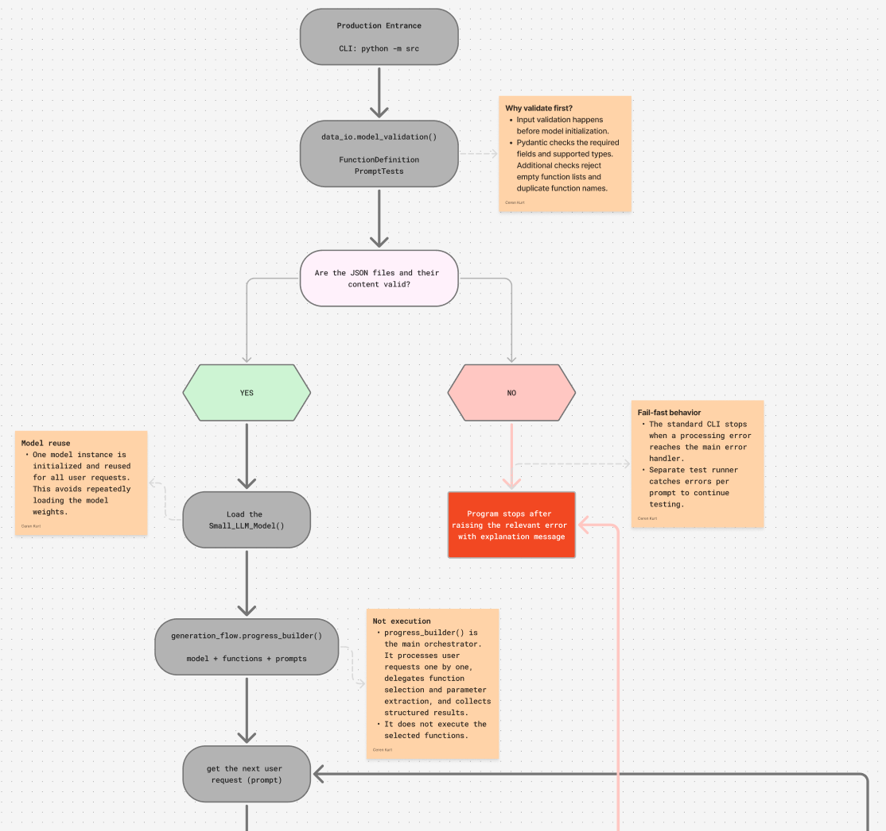
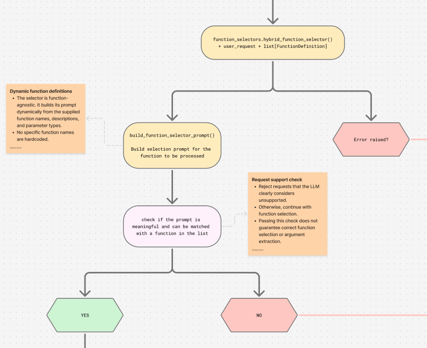
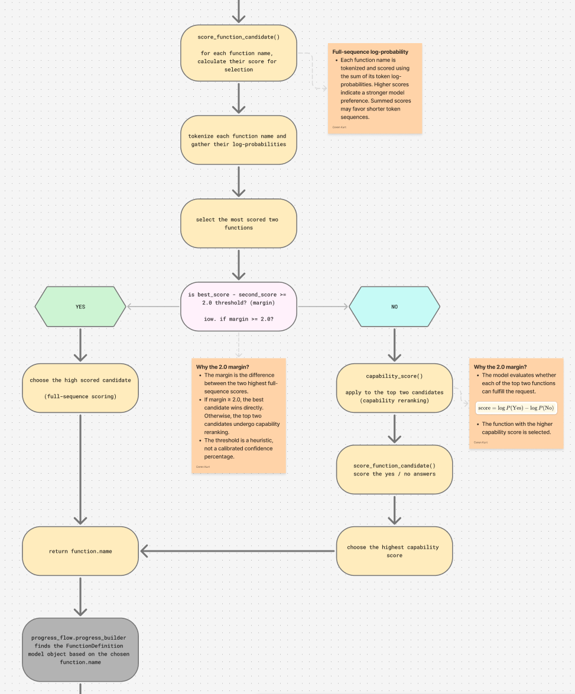
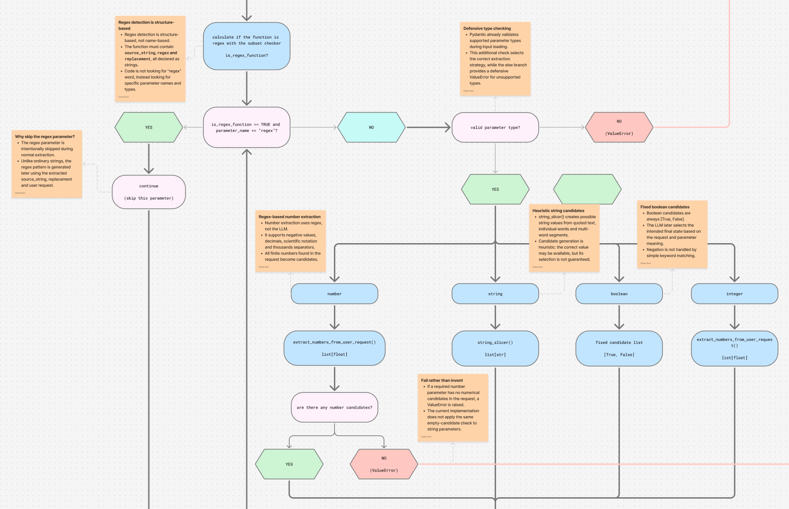
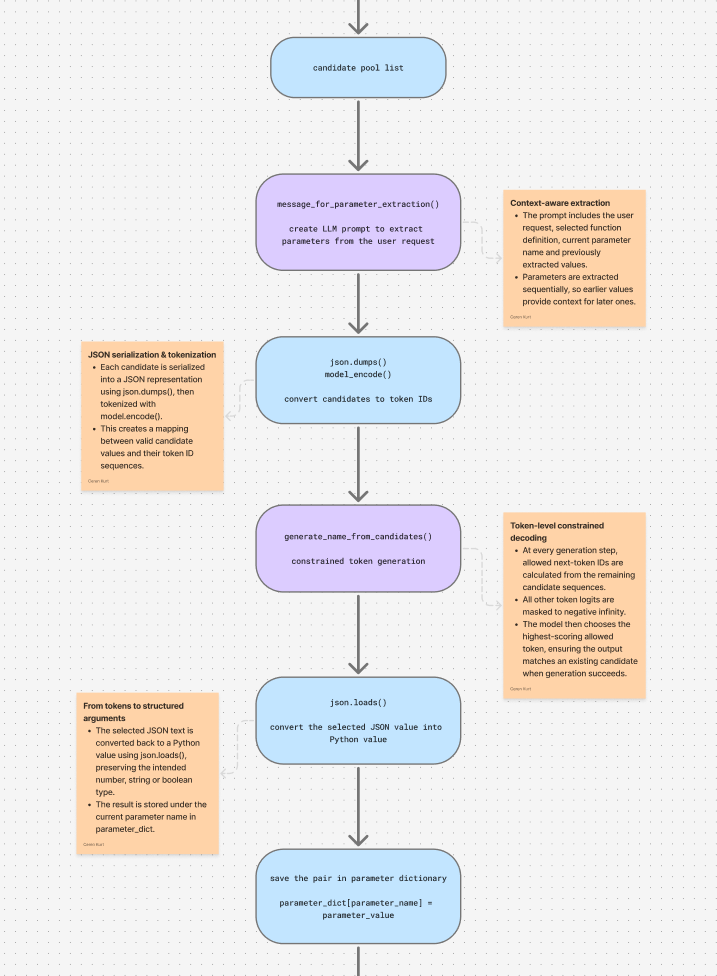
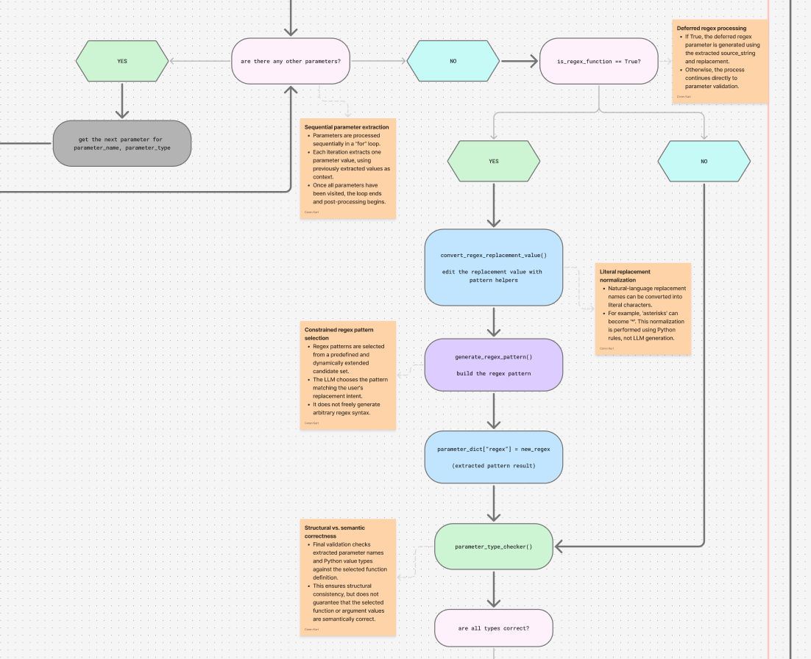
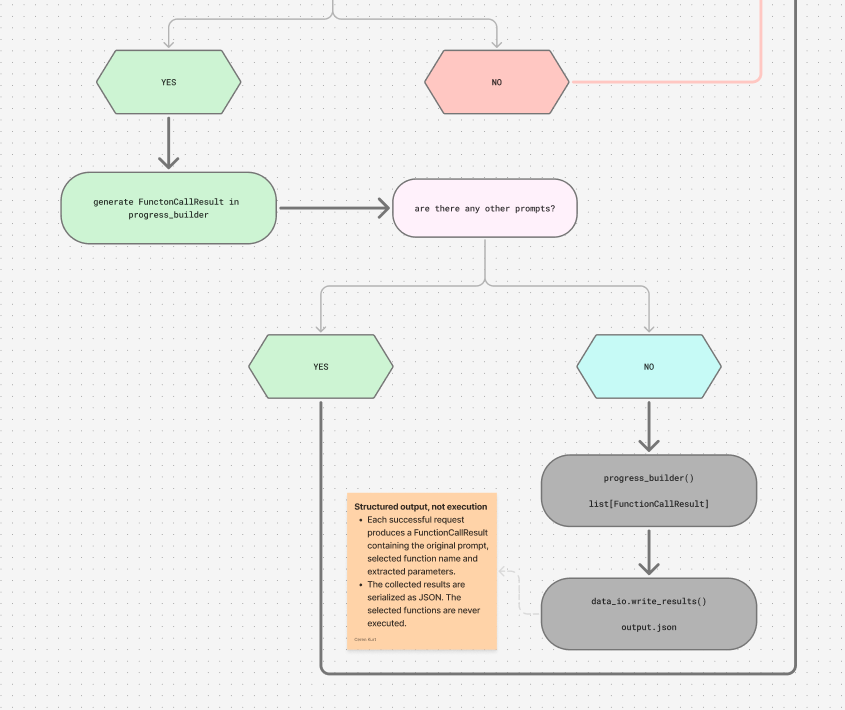

*This project has been created as part of the 42 curriculum by cerkurt.*

# call_me_maybe

A local function-calling tool that translates natural-language requests into 
function names and typed arguments using a small language model, hybrid function selection, 
and token-level constrained argument extraction.

## Contents

- [Description](#description)
- [Instructions](#instructions)
- [Input and output formats](#input-and-output-formats)
- [Project structure](#project-structure)
- [Architecture diagram](#architecture-diagram)
- [Algorithm explanation](#algorithm-explanation)
- [Design decisions](#design-decisions)
- [Challenges encountered](#challenges-encountered)
- [Testing strategy](#testing-strategy)
- [Performance analysis](#performance-analysis)
- [Resources and AI usage](#resources-and-ai-usage)

## Description

Given a request such as `What is the sum of 40 and 2?`, the program identifies
the appropriate function and extracts its input arguments. The result is a
structured call:

```json
[
    {
        "prompt": "What is the sum of 40 and 2?",
        "name": "fn_add_numbers",
        "parameters": {
            "a": 40.0,
            "b": 2.0
        }
    }
]
```

The output describes the call; the application does not execute the selected
function or calculate its return value.

Function definitions are supplied through JSON files. Their names,
descriptions, parameter names, and declared types drive the selection and
validation process. The currently supported parameter and return type
declarations are `number`, `string`, and `boolean`.

The supplied `Small_LLM_Model` SDK loads `Qwen/Qwen3-0.6B` by default.
The application uses its public encoding, decoding, and logit methods.
During argument extraction and regex option selection, invalid candidate
continuations are masked before the next token is selected. Function-name
selection instead scores complete available names and may rerank the two
leaders with a separate capability prompt.

## Instructions

### Requirements and installation

- Python **3.10+**, as specified in `pyproject.toml` and the project subject.
- [uv](https://docs.astral.sh/uv/getting-started/installation/) for dependency and environment management.
- The supplied `llm_sdk/` workspace package.
- Internet access for the initial dependency and model downloads. Subsequent runs can reuse cached model files.

From the repository root, install the project dependencies:

```bash
make install
```

This target runs `uv sync`. Alternatively, the same installation can be performed directly:

```bash
uv sync
```

The application automatically creates missing output directories when writing results. 
Generated files under `data/output/` are excluded from Git and are not included in the 
submitted repository.

### Run the provided 11-prompt input

Run the application using its default input and output paths:

```bash
make run
```

The equivalent Python CLI command is:

```bash
uv run python -m src
```

The default paths are:

| CLI option | Default path |
|---|---|
| `--functions_definition` | `data/input/functions_definition.json` |
| `--input` | `data/input/function_calling_tests.json` |
| `--output` | `data/output/function_calling_results.json` |

The standard CLI processes the provided prompts and writes a single JSON array containing 
their generated function calls. Each result includes the original prompt, selected 
function name, and extracted parameters.

The `make run` target also measures total execution time using `/usr/bin/time -p`. 
The reported `real` value represents the elapsed wall-clock time, including startup, model initialization, 
generation, and output writing.

If an error occurs during processing, the standard CLI stops the batch and does not 
write a new partial result file.

### Run one custom prompt

To test an individual request using the default function definitions, create a JSON file 
containing one prompt:

```bash
printf '[{"prompt":"What is the sum of 40 and 2?"}]\n' > /tmp/cmm_one_prompt.json
```

Run the application with the custom input path:

```bash
uv run python -m src \
  --input /tmp/cmm_one_prompt.json \
  --output data/output/one_prompt_result.json
```

Inspect the generated JSON:

```bash
uv run python -m json.tool data/output/one_prompt_result.json
```

The request text can be replaced with another prompt. The input file must remain a JSON 
array of objects containing the `prompt` field. Special characters and quotation marks 
must follow valid JSON escaping rules.

### Run with custom function definitions

The application reads available function names, descriptions, and parameter types from 
the supplied JSON definitions. It does not require hardcoded selection rules for individual 
function names.

Custom function definitions, prompts, and output paths can be supplied independently:

```bash
uv run python -m src \
  --functions_definition path/to/functions.json \
  --input path/to/prompts.json \
  --output data/output/custom_results.json
```

This allows the same application to process different sets of functions and natural-language 
requests without modifying the source code.

The standard CLI stops processing if a request raises an error. It does not automatically 
skip failed requests or evaluate generated calls against expected answers.

### CLI help and output inspection

Display the available command-line options:

```bash
uv run python -m src --help
```

Inspect the default output file:

```bash
uv run python -m json.tool data/output/function_calling_results.json
```

The JSON inspection command checks syntax and displays the generated structure. It does not 
verify whether the selected function or argument values match the user's intended request.

### Error handling

The application reports input, validation, generation, and output-writing errors at the CLI 
boundary. Handled failures terminate execution with a nonzero exit status and a descriptive 
error message.

These include missing input files, malformed JSON, invalid Pydantic models, unsupported 
parameter types, exhausted generation, and file-writing failures.

Input validation also rejects empty function definition lists, blank function names, and 
duplicate function names.

An empty prompt list is allowed and produces an empty result array. This is different from a list 
containing a prompt with an empty string, which represents a request entry with no text.

The application validates output parameter names and declared types before writing the results. 
Structural validation does not guarantee that the selected function and arguments are 
semantically correct.

### Makefile commands and code-quality checks

Run all Makefile commands from the repository root.

#### Setup and execution

| Command | Description |
|---|---|
| `make install` | Install and synchronize project dependencies using `uv sync`. |
| `make run` | Run the application with its default inputs and report execution time. |
| `make debug` | Run the application with Python's `pdb` debugger. |
| `make clean` | Remove Python bytecode, development caches, and generated files under `data/output/`. |

#### Code-quality checks

| Command | Description |
|---|---|
| `make lint` | Run Flake8 and mypy with the configured project flags. |
| `make lint-strict` | Run Flake8 and mypy with additional `--strict` type checking. |

Run the standard checks:

```bash
make lint
```

The mypy command includes:

- `--warn-return-any`
- `--warn-unused-ignores`
- `--ignore-missing-imports`
- `--disallow-untyped-defs`
- `--check-untyped-defs`

For additional type checking:

```bash
make lint-strict
```

Flake8 excludes `.venv/`, `venv/`, `llm_sdk/`, and `moulinette/`, as
configured in `.flake8`. Mypy excludes `.venv/`, `llm_sdk/`, `tests/`, and
`moulinette/` from recursive file discovery, as configured in `pyproject.toml`.
These exclusions apply to both `make lint` and `make lint-strict`, including
when the moulinette directory is added later for evaluation.

#### CLI test suites

| Command | Description |
|---|---|
| `make test-errors` | Run nine error scenarios independently, displaying each result and continuing after failed CLI runs. |
| `make test-21` | Process the 21-prompt suite and write `data/output/results_21.json`. |
| `make compare-21` | Compare the saved 21-prompt results against the expected calls. |
| `make test-42` | Process the 42-prompt suite and write `data/output/results_42.json`. |
| `make compare-42` | Compare the saved 42-prompt results against the expected calls. |

Generate results before comparing them:

```bash
make test-21
make compare-21

make test-42
make compare-42
```

Only run a comparison after generation completes successfully.
The comparison commands read existing output files without loading the
model. They report matching calls, mismatches, missing results, extra
results, and exact-call accuracy.

The error-case runner displays the application's behavior for manual
inspection; it does not automatically assert that each error is correct.

#### Moulinette evaluation

These commands require the `moulinette/` directory in the repository root.

| Command | Description |
|---|---|
| `make moulinette-prepare` | Synchronize moulinette dependencies and generate the private exercises. |
| `make moulinette-run` | Run the application on those exercises and write `data/output/moulinette_results.json`. |
| `make moulinette-grade` | Grade the existing result file using the private exercise set. |
| `make test-moulinette` | Run preparation, answer generation, and grading sequentially. |

Run the complete workflow:

```bash
make test-moulinette
```

To evaluate code changes using already prepared exercises, regenerate the
answers and then grade them:

```bash
make moulinette-run
make moulinette-grade
```

The complete workflow stops if a command returns a nonzero exit status.
Grading results should also be inspected in the terminal.

## Input and output formats

### Function definitions

The definitions file contains a JSON array. Each item describes one function:

```json
[
    {
        "name": "fn_add_numbers",
        "description": "Add two numbers together and return their sum.",
        "parameters": {
            "a": {
                "type": "number"
            },
            "b": {
                "type": "number"
            }
        },
        "returns": {
            "type": "number"
        }
    }
]
```

A declared return type describes the available function. It is not a result
the application needs to compute.

Pydantic converts these dictionaries into `FunctionDefinition` objects
containing nested `ParameterDefinition` and `ReturnDefinition` objects.

### Prompt tests

The prompts file contains an array of requests:

```json
[
    {
        "prompt": "What is the sum of 40 and 2?"
    }
]
```

Each item is validated as a `PromptTest`.

### Results

Each successfully processed request produces one FunctionCallResult containing 
the following output fields:

| Field | Meaning |
|---|---|
| `prompt` | The original request text. |
| `name` | The selected function name. |
| `parameters` | The complete dictionary of extracted argument values. |

### JSON value types

Parameter types are declared as `"number"`, `"string"`, or `"boolean"` in the 
function definitions. However, the generated output contains actual JSON values, 
not their type names.

For example, with appropriate custom function definitions, the output may look like this:

```json
[
    {
        "prompt": "Set the temperature to 18 degrees for room 'office'.",
        "name": "set_temperature",
        "parameters": {
            "room": "office",
            "degrees": 18.0
        }
    },
    {
        "prompt": "Disable notifications for room 'kitchen'.",
        "name": "set_notifications",
        "parameters": {
            "room": "kitchen",
            "enabled": false
        }
    }
]
```

In the output:

- `"office"` and `"kitchen"` are JSON strings.
- `18.0` is a JSON number, not a quoted string.
- `false` is a JSON boolean, not the string `"false"`.

The current numeric extractor converts recognized numeric values to Python `float` objects. 
JSON supports both integer and floating-point number representations for parameters 
declared as `"number"`.

## Project structure

The application separates command-line execution, data validation, model inference,
and argument extraction into dedicated modules. Documentation assets and CLI test
fixtures are stored separately. The overview below lists the main files and
directories without expanding individual PNG images:

```text
.
├── src/
│   ├── __init__.py              # Package initialization
│   ├── __main__.py              # CLI, model initialization, error handling
│   ├── colors.py                # Shared ANSI color constants
│   ├── data_io.py               # JSON loading, validation, and writing
│   ├── data_models.py           # Pydantic schemas and parameter type checks
│   ├── generation_flow.py       # Main function-calling pipeline
│   ├── function_selectors.py    # Request support checks and hybrid selection
│   ├── parameter_extractors.py  # Argument candidates and extraction prompts
│   ├── llm_helpers.py           # Token scoring and constrained decoding
│   └── regex_helpers.py         # Regex candidate selection and replacement
├── data/
│   ├── input/
│   │   ├── functions_definition.json
│   │   └── function_calling_tests.json
│   └── output/                  # Created at runtime; excluded from Git
├── docs/
│   ├── concept/
│   │   ├── png/                 # Concept presentation images
│   │   └── index.html           # Concept presentation viewer
│   ├── workflow.pdf             # Combined architecture diagram
│   └── call_me_maybe_v1_5.pdf   # Project subject
├── test_suite/
│   ├── 01_errors/               # Invalid inputs and supporting fixtures
│   ├── 02_prompts_21/
│   │   ├── functions.json       # Available function definitions
│   │   ├── prompts.json         # Requests to process
│   │   └── expected.json        # Expected function calls and arguments
│   ├── 03_prompts_42/
│   │   ├── functions.json
│   │   ├── prompts.json
│   │   └── expected.json
│   ├── run_error_cases.py       # Run error scenarios independently
│   ├── compare_results.py       # Compare expected and actual results
│   └── README.md                # Detailed test instructions
├── llm_sdk/                     # Supplied uv workspace package
├── pyproject.toml
├── uv.lock
├── Makefile
├── .flake8
├── .gitignore
└── README.md
```

The architecture screenshots are stored directly in `docs/`. The concept
presentation uses `docs/concept/index.html` and its images in `docs/concept/png/`.

The entry point, `src/__main__.py`, validates the input files, initializes the model,
and calls `generation_flow.progress_builder()`. The pipeline coordinates request
support checks, function selection, parameter extraction, regex handling, and final
result validation. The CLI then writes the collected results through `data_io`.

The `data/output/` directory is created automatically when results are written and
is excluded from the submitted repository through `.gitignore`.

## Architecture diagram

Explore the complete application flow on
[FigJam](https://www.figma.com/board/3LcRyYZk3coNHkmvc3bKv7/call_me_maybe_codam_cerkurt?node-id=0-1).

The screenshots below divide the diagram into seven consecutive sections.
All seven sections are displayed below. Click an image to open it separately.

### 1. Input validation and model initialization

Validate the input files before loading the model. Reuse one model instance
across requests and pass the validated data to the generation pipeline.

[](docs/section1.png)

### 2. Request support check

Use the LLM to identify clearly unsupported requests before ranking function
names. Passing this check allows processing to continue; it does not
guarantee a correct function call.

[](docs/section2.png)

### 3. Hybrid function selection

Score complete function names using token log-probabilities. When the two
leading scores are close, compare their capabilities using separate
Yes/No scores.

[](docs/section3.png)

### 4. Typed argument candidates

Build candidate values according to each parameter's declared type:
number, integer, string, or boolean. Defer the special regex parameter
until its source text and replacement have been extracted.

[](docs/section4.png)

### 5. Constrained argument extraction

Prepare the extraction prompt, serialize and encode the candidates,
and mask disallowed next-token IDs during generation. Parse the selected
JSON value and store it in the parameter dictionary.

[](docs/section5.png)

### 6. Regex handling and final validation

After ordinary argument extraction, normalize supported replacement names
and select a regex pattern when required. Validate the complete argument
dictionary against the selected function definition.

[](docs/section6.png)

### 7. Result collection and JSON output

Collect one structured result per successfully processed request.
After all requests complete, serialize the results into the output JSON
file. The application describes function calls without executing them.

[](docs/section7.png)

## Algorithm explanation

### End-to-end overview

`progress_builder()` orchestrates the requests. It does not execute
functions; it produces descriptions of calls. It reuses the same
`Small_LLM_Model` instance across requests.

### 1. Select the function: full scoring inside the hybrid selector

**Full scoring and hybrid selection are connected stages of one selector,
not two independent modes selected by a CLI flag.** For every request,
`generation_flow.progress_builder()` calls
`function_selectors.hybrid_function_selector()`. That function first ranks
every available function by a full-sequence score. Only a close result
triggers the additional capability comparison.

`build_function_selector_prompt()` includes the actual request and the
supplied function names, descriptions, and parameter names/types. System
and user chat messages are followed by the open assistant prefix:

```text
<|im_start|>assistant
<think>

</think>

```

#### A. Full scoring: compare each complete function name

`llm_helpers.score_function_candidate()` evaluates a **known continuation**.
It encodes one function name and scores all its tokens in order. At each
step, it obtains logits, converts the specified token's score into a log
probability, then appends that specified token to the context to score
the next one. It does not select the highest-logit token at that step.
The prompt context is reset before evaluating the next candidate name.

```text
name_score = sum of log P(token_i | prompt and earlier name tokens)
```

The code computes the normalization with a stable log-sum-exp calculation:
It subtracts the largest logit before exponentiation. The final score is
a sum of conditional log-probabilities, not a percentage. A larger score
is better; for example, -1.2 ranks above -4.6. Scores are not divided by
the number of tokens, so candidate-name length can affect ranking.

Why compare complete names? A greedy token-by-token decoder commits to the 
strongest allowed next token without evaluating the full continuation of 
every candidate. A locally preferred token does not necessarily begin 
the strongest complete continuation. Consider these **invented** scores 
after a shared prefix, with two tokens left in each candidate:

| Candidate | First differing token | Following token | Total |
|---|---:|---:|---:|
| A | -0.6 | -4.0 | -4.6 |
| B | -1.0 | -0.2 | -1.2 |

Greedy selection would take A's first differing token because -0.6 is
higher than -1.0. Full scoring evaluates both complete continuations and
prefers B. This gives every supplied name a complete evaluation without
allowing an invented name. It is a different selection criterion, not a
guarantee that the model's preferred name has the right meaning.

#### B. Hybrid selection: use an extra check when the leaders are close

The selector retains the best and second-best full scores and calculates:

```text
margin = best_score - second_score
```

A gap of at least **2.0** returns the full-score leader directly. A smaller
gap runs `capability_score()` for each of the top two definitions. This
helper prepares a separate prompt asking whether that one function can
fulfill the request using suitable arguments. It includes the function's
description and parameter declarations. The same SDK model then scores
the fixed answers `Yes` and `No`:

```text
capability = full_score(Yes) - full_score(No)
```

The code scores **both** answers; it does not need to freely generate a
Yes/No explanation. The larger difference wins. If capability scores
tie, the original full-score leader wins. The original leader is also
returned when it is the only candidate after scoring.

The `2.0` threshold is a heuristic applied to the difference between accumulated
log-probability scores. It is not a calibrated confidence percentage. A larger
threshold would trigger capability reranking more often, potentially increasing
execution time without necessarily improving accuracy.

For an **illustrative** example, full scores -2.1 and -2.8 have a margin
of 0.7, which triggers the extra check. If the capability differences
are 0.2 and 3.0 respectively, the second candidate replaces the original
leader. With scores -1.0 and -4.0, the margin is 3.0 and no extra check runs.
These numbers explain control flow; they are not measured test outputs.

Capability reranking considers only the two highest-ranked functions from the first
stage. Therefore, it cannot recover the correct function if that function was
ranked outside the top two.

#### Why the extra stage was introduced and what it costs

The additional question separates two judgments: how likely the function's
name is as a continuation of the selection prompt, and whether that
function's described capability fits the request. Requests involving
negation or overlapping capabilities exposed wrong name selections during
development. A capability prompt gives close candidates another comparison
based on one definition at a time rather than the entire displayed list.
It uses the same model, not a second model or an independent correctness
oracle.

The margin rule limits the cost of this second comparison. Close requests
require four extra continuation scores: Yes and No for each of two
functions. Each score can require multiple SDK logit calls. All function
names are already scored before the margin check, so this approach does
more work than one greedy name continuation.

This design provides a complete-name comparison and a bounded opportunity to 
revise an ambiguous ranking, at the cost of additional inference.

The `2.0` threshold is a heuristic based on the difference between accumulated 
log-probability scores, not a calibrated confidence measure. A large margin can 
skip a potentially useful capability check. Furthermore, reranking is limited to 
the top two candidates, so it cannot recover a correct function ranked lower. 

Increasing the threshold would trigger more reranking but would not eliminate 
this shortlist limitation.

#### Relation to constrained argument decoding

Function selection returns a name from the supplied definitions by scoring
fixed names and, when needed, capability answers. After that, argument
values and regex option codes use `generate_name_from_candidates()` with
token-prefix constraints and logit masking.

### 2. Determine parameter extraction strategy

After matching the selected name back to its `FunctionDefinition`, the
pipeline recognizes a regex-specialized schema **once per selected
function** and creates a new parameter dictionary.

For every declared parameter, it either skips the special `regex` field
(to be generated later), or selects an extraction strategy by its type:

| Declared type | Candidate construction |
|---|---|
| `number` | Extract signed integers, decimals (including `.5`), scientific notation (`1e3`) and comma-grouped forms (`1,000`), then convert to finite floats. |
| `string` | Collect quoted contents, individual chunks, two- and three-word segments outside recognized quotes, and chunks with trailing .!? removed. Deduplicate in first-seen order. Do not append the full request as a fallback. |
| `boolean` | Offer the fixed candidate set `[True, False]`. |

If a number parameter has **no numerical candidates**, a descriptive
`ValueError` is raised rather than fabricating a value. For strings,
both candidate coverage and the model's semantic selection remain
possible sources of error.

`message_for_parameter_extraction()` constructs the LLM prompt using:
the original request, selected function and description, parameter
names/types, **the current parameter**, and values already extracted.
Earlier values help provide context for subsequent parameters, but do
not prevent the same valid value from being used more than once.

### 3. Prepare candidates and run constrained token decoding

Each candidate is serialized using `json.dumps()` and encoded into a
token-ID sequence with the SDK's `encode()` method. The implementation
prepends a space before the serialized candidate, matching the open JSON
prefix of the parameter prompt. Tokenization is sensitive to whitespace
and position: `encode(prefix) + encode(value)` is not necessarily the
same token sequence as `encode(prefix + value)`.

`generate_name_from_candidates()` uses the token sequences to constrain
greedy selection, rather than random sampling. At every generation step:

1. `find_allowed_next_token_ids()` identifies the next token IDs for
   every candidate still matching the generated prefix.
2. `get_logits_from_input_ids()` obtains next-token scores from the
   model, conditioned on the prompt plus previously generated tokens.
3. `select_next_token_id()` masks every disallowed logit to `-inf`,
   without changing token indexes, and selects the strongest allowed ID.
4. The generated ID extends both the full model context and the
   candidate-matching prefix. Generation stops when a complete candidate is
   reached. A `ValueError` is raised if no valid continuation is available
   or the generation token limit is exhausted.

For illustration, imagine that two candidate values are encoded as:

```text
candidate_a → [10, 20]
candidate_b → [10, 30]
```

| Already generated | Allowed next tokens |
|---|---|
| `[]` | `{10}` |
| `[10]` | `{20, 30}` |
| `[10, 20]` | Completed `candidate_a` |

The selected candidate is returned as JSON text and converted to the
corresponding Python value with `json.loads()`. It is stored under the
current parameter name in `parameter_dict`. The cycle repeats until all
ordinary parameters have been visited.

A constrained output is **guaranteed to be selected from the supplied
candidates when generation succeeds**, but it is not guaranteed to be
the semantically correct choice.

### 4. Complete regex parameters when recognized

A function activates regex-specific processing only when its definition
contains `source_string`, `regex`, and `replacement`, **all declared as
strings**. Detection depends on the parameter schema, not the function
name.

The `regex` field is skipped during the ordinary extraction loop; the
other parameters are extracted first. After the loop:

1. `convert_regex_replacement_value()` normalizes supported unquoted character 
   punctuation — plus eligible request-derived quoted literals.
2. `regex_candidate_generator()` provides seven category patterns —
   vowels, letters, digit sequences, uppercase, lowercase, whitespace,
   punctuation — plus eligible request-derived quoted literals.
3. `generate_regex_pattern()` maps these to short option labels and
   uses constrained token selection to choose the best one.
4. The selected option is translated back to a regex pattern and stored
   in `parameter_dict["regex"]`.

Examples include `[aeiouAEIOU]` for vowels and `[0-9]+` for digit
sequences. This is **bounded pattern selection**, not arbitrary regex
synthesis. The application does not call `re.sub()` as part of function
execution; replacement examples were verified separately in tests.

### 5. Validate and write the structured result

`parameter_type_checker()` confirms that all required parameter names are
present, no unexpected names were added, and values match their declared
types. The numeric check accepts `int` values and finite `float` values but rejects
`bool`, which Python otherwise considers a subclass of `int`.

Successful requests yield one `FunctionCallResult` each, with precisely
`prompt`, `name`, and `parameters`. After the request loop completes,
`model_dump()` provides Python dictionaries, and
`json.dumps(..., allow_nan=False)` serializes the array to UTF-8 JSON.

Successful requests yield one `FunctionCallResult` each, containing `prompt`, 
`name`, and `parameters`. After the request loop completes, `model_dump()` converts 
the result models into Python dictionaries, and `json.dumps(..., allow_nan=False)` 
serializes the complete list. The output writer creates missing parent directories and 
writes the resulting JSON text using UTF-8 encoding.

Pydantic and the final parameter checker validate structure and types. They cannot prove 
that a chosen function or argument corresponds to the user's intended meaning. 
This distinction is evaluated separately in the testing strategy.

## Design decisions

- **Separate I/O, data models, generation, and orchestration.** Each module
  has a distinct responsibility. Reusable functions receive file paths, validated
  objects, or an existing SDK model rather than managing unrelated tasks.

- **Reuse one model instance.** The SDK model is initialized once, after input
  validation, and shared across requests to avoid repeated loading costs.

- **Use dynamic function definitions.** Function names, descriptions, and parameter
  types are read from the supplied JSON file instead of hardcoding rules for individual
  functions. This allows the same selection pipeline to work with new function
  definitions without modifying the source code.

- **Combine full-sequence scoring with conditional capability reranking.** Scoring
  complete function names avoids committing to an early greedy token choice. Capability
  reranking is reserved for close candidates to balance selection quality and inference cost.

- **Constrain argument generation to predefined candidates.** Prompt wording provides
  semantic context, while token-level logit masking restricts argument values and regex
  option codes to available candidates.

- **Retain extraction context.** Previously extracted parameter values are included in the
  prompt for subsequent parameters, helping the model distinguish between arguments without
  preventing valid repeated values.

- **Share prompt assembly across parameter types.** A single prompt builder handles number,
  string, and boolean parameters, using type-specific instructions while sharing function
  metadata, extracted values, chat roles, and JSON formatting.

- **Expand the candidate pool before constraining selection.** Quoted strings and word n-grams
  make multiword arguments available without assuming that every quoted phrase is the intended
  value. Constrained decoding then selects from the constructed pool.

- **Defer regex pattern extraction.** Recognized regex schemas extract the source string and
  replacement first, allowing a specialized, bounded pattern-selection step to use those values
  as context.

- **Accumulate one complete result per request.** Parameter dictionaries are initialized
  outside the inner parameter loop, so all extracted arguments are collected before constructing
  a single `FunctionCallResult`.

- **Report errors at the CLI boundary.** Lower-level functions propagate errors, while the CLI
  handles them with descriptive messages and nonzero exit statuses.

## Challenges encountered

### Whitespace changes token boundaries and model scores

A leading or trailing space is part of the token sequence. During development,
moving a space between the JSON prefix and the value candidate changed the
IDs presented to the model and the allowed next-token choices.

For example, the following were measured through the SDK tokenizer:

| Text supplied to `encode()` | IDs |
|---|---|
| A single space | `[220]` |
| A double quote | `[1]` |
| A space followed by a double quote | `[330]` |
| `"cat"` | `[1, 4616, 1]` |
| A space followed by `"cat"` | `[330, 4616, 1]` |
| `"cat"` followed by a space | `[1, 4616, 1, 220]` |
| A minus sign | `[12]` |
| A space followed by a minus sign | `[481]` |

These IDs describe the inspected tokenizer, not a universal vocabulary.

Consider two ways to construct the same visible boundary:

```text
A: encode(prefix ending in ": ") + encode("\"cat\"")
B: encode(prefix ending in ":")  + encode(" \"cat\"")
```

The concatenated text can look identical while the concatenated token-ID
lists differ. In general:

```text
encode(prefix) + encode(value) != encode(prefix + value)
```

In case A, a separate space and quote can produce IDs `220` and `1`.
In case B, the combined space-plus-quote token can be `330`.
The model is then evaluating different token continuations at different
positions, so the logits are not directly interchangeable.

Whitespace also has a data-level meaning:

| JSON text | Decoded value |
|---|---|
| `"cat"` | Three characters: `cat` |
| `"cat" ` | The same three-character value; the space is outside the string. |
| `"cat "` | Four characters; the final space belongs to the argument. |

The current implementation ends the JSON prefix at the colon and prepends a 
space to each serialized candidate. This keeps the tokenization convention 
consistent during constrained decoding. Whitespace placement affects token 
boundaries but does not guarantee semantically correct selection.

### A correct value must be present in the candidate pool

One request exposed a candidate-extraction error:

```text
Set the temperature to 18 degrees for room 'office'.
```

The outside-quotes splitter retained `'office'.`. Its final character was
a period, so the condition that removed matching outer quotes did not apply.
The plain `office` value was absent from the pool, making it unavailable
to constrained selection.

The inside-quotes helper already found `office`. Its results were added
to the candidate pool for multi-parameter functions, which fixed the
temperature example.

This led to a useful debugging order: inspect candidate construction before
changing the model prompt.

### Multiword values needed both a larger pool and clearer instructions

An earlier pool could offer only separate words for an unquoted full name.
For `Greet Jane Doe`, selecting either `Jane` or `Doe` loses part of
the requested value. Adding contiguous two- and three-word phrases makes
`Jane Doe` available without manually encoding a specific person's name.

Pool construction and prompting solve different parts of this problem.
The shared builder's string instruction asks for the complete current
argument and distinguishes it from the command. In
`Greet Jane Doe using the word 'hello'`, both the name and the quoted
word remain candidates; the function description and parameter name must
guide the model to the name.

The current implementation deduplicates words, phrases, quoted spans,
and punctuation-trimmed chunks. Unlike that earlier version, it does not
append the entire request as a fallback. It does not enumerate every possible
substring. A targeted pool check still finds no
`First Second Third Fourth` candidate for the longer command
`Greet First Second Third Fourth`.

### Valid JSON regexes could still match the wrong characters

The experimental free-string path could produce a complete JSON string
whose content was the wrong regex. For example, `[a-zA-Z]+` is a valid
pattern but replaces whole letter sequences when the request asks only
for vowels. Testing only `json.loads()` would miss that error.

Extended checks therefore applied the selected pattern to source text:

| Source | Pattern | Replacement | Expected substitution result |
|---|---|---|---|
| `Room 12` | `[0-9]+` | `X` | `Room X` |
| `Programming is fun` | `[aeiouAEIOU]` | `*` | `Pr*gr*mm*ng *s f*n` |
| `The cat sat on the mat with another cat` | `cat` | `dog` | `The dog sat on the mat with another dog` |

Selecting short option codes from a described pattern catalog gave a
usable bounded path. The code, descriptive label, regex text, and encoded
token sequence have separate roles. Encoding the option codes constrains
the model's answer to the displayed choices; mapping back supplies the
actual pattern. Prompt wording still affects which allowed option wins.
The catalog is therefore documented as limited support, rather than a
guarantee of arbitrary regex generation.

The literal replacement `asterisks` exposed a separate issue: even the
correct vowel pattern inserts that word repeatedly unless the requested
symbol is interpreted as `*`. The small quote-aware character-name helper
addresses the supported cases while preserving quoted literal text.

### Numeric parsing improvements do not guarantee the chosen argument

The initial numeric pattern incorrectly split values such as `.5`, scientific 
notation, and comma-grouped numbers. The updated extractor recognizes these 
formats and converts `.5` to `0.5`, `1e3` to `1000.0`, and `1,000` to `1000.0`.

The extractor also preserves signed values, including both `0.5` and `-0.5` 
in requests such as `Add 0.5 and -0.5.`. Previously selected values are not 
removed from subsequent candidate pools, allowing valid repeated arguments 
such as `Add 7 and 7.`.

Numeric extraction and semantic selection remain separate responsibilities: 
making a value available does not guarantee that the model will assign it to 
the correct parameter.

### Quoted text, escape characters, and Unicode require careful handling

Natural-language requests may contain quoted strings, apostrophes, escaped 
characters, and Unicode text. These must be handled carefully to preserve the 
intended argument value.

For example, `Reverse 'hello world' please` contains a quoted argument with an 
internal space. Splitting the request only on whitespace would lose that grouping.

String processing also involves several interpretation layers:

1. **Python strings:** Escape sequences may be interpreted before a function receives a string.
2. **JSON input:** Strings must follow JSON escaping rules, including escaped quotation marks and control characters.
3. **Natural-language requests:** Quotes may delimit an argument or be part of its content.
4. **JSON output:** Extracted values must be serialized without changing their intended meaning.

For example, a newline character and the literal characters `\` and `n` are 
different Python strings:

```python
actual_newline = "\n"
escaped_newline = "\\n"

assert len(actual_newline) == 1
assert len(escaped_newline) == 2
```

Unicode characters introduce another representation distinction. For example, 
the JSON string:

```json
{
    "text": "\u00c7a\u011fr\u0131 \ud83c\udf21\ufe0f"
}
```

decodes to the same text as:

```text
Çağrı 🌡️
```

The output writer uses UTF-8 encoding and `ensure_ascii=False` so Unicode characters 
remain readable in the generated JSON file. Escaped and literal Unicode representations 
may look different in the file while decoding to the same string value.

During development, inspecting `repr()` and testing JSON round trips with `json.loads()` 
helped distinguish actual string contents from their serialized representations.

The current string extractors handle the tested quoting cases, but escaped quote delimiters 
and ambiguous natural-language quoting remain areas where broader coverage is needed.

A recent regression exposed another edge case involving empty quoted strings. 
For the request `Echo ''.`, the expected argument was an empty string (`""`), 
but the extractor returned `"''"`, containing the two quote characters instead.

Both values are valid strings, so Pydantic and the final type checker cannot 
detect this semantic mismatch. The result suggests that quote delimiters may be 
retained during candidate construction or that the model selects a candidate 
containing the delimiters instead of the empty value. The exact cause has not 
yet been confirmed.

This remains an unresolved edge case. It demonstrates why quoted-value extraction 
needs dedicated regression tests, particularly after changes to string candidate 
construction and selection.

### Schema validity and the intended meaning need different checks

A generated argument can have the correct JSON type while still representing 
the wrong value. For example, selecting `"string"` instead of `"hello"` for 
`Reverse the string 'hello'` produces a valid string argument but does not 
satisfy the request.

Similarly, `disabled: true` is structurally valid for a boolean parameter but 
contradicts an instruction to enable notifications.

Constrained decoding guarantees candidate membership when generation succeeds, 
while Pydantic and the parameter checker validate structure and types. Semantic 
correctness requires a separate comparison against the intended function call.

### Function selection was sensitive to prompt structure

During development, adding another function definition exposed incorrect 
function-name selections. The model's ranking changed significantly depending 
on how function metadata and the user request were formatted.

Using explicit system and user message boundaries, followed by the model's 
expected open assistant prefix, improved selection behavior in targeted diagnostics.

This demonstrated that model scores depend not only on the candidate function 
names but also on the surrounding prompt context. The final hybrid selector retains 
structured prompting while evaluating complete function-name continuations and 
conditionally reranking close candidates.

### Exceptions belong at the right boundary

A missing file already raises an error from `open()`. A malformed JSON
document raises a decoding error from `json.load()`. A mismatched Pydantic
field raises a validation error.

A lower-level `except` block that only re-raises the same error adds no
new handling. The CLI provides context and an exit status for handled
failures. Stopping after a failed generation also avoids continuing with
a result variable that was never assigned.

Result serialization is completed before output directories are created or 
files are opened, preventing serialization failures from modifying existing 
output files.

## Testing Strategy

The application was tested using the original project inputs, additional valid 
requests, and deliberately invalid inputs. The goal was to verify not only that 
the application produces valid JSON, but also that it selects the intended 
function and extracts the correct argument values.

A separate `test_suite/` directory contains supplementary test fixtures, expected 
outputs, a result comparison script, and an error-case runner. These tests 
extend the mandatory examples without modifying the supplied input files.

### Test coverage

Four groups of tests were executed:

| Test group | Scope | Result |
|---|---|---|
| Mandatory inputs | 11 prompts, 5 function definitions | 11/11 correct |
| Error handling | 9 invalid-input/error scenarios | 9/9 handled |
| Extended 21 | 21 prompts | 21/21 correct |
| Extended 42 | 42 prompts, 8 function definitions | 40/42 correct |

The extended tests cover function selection, numeric arguments, quoted and unquoted 
strings, multiword values, Unicode, empty strings, boolean interpretation, and 
regex pattern selection.

The error-case tests exercise invalid or unsupported inputs, including malformed 
JSON, invalid function definitions, missing required fields, and requests for 
numerical arguments without extractable numbers.

### Validation methodology

The test process distinguishes three levels of correctness:

1. **Structural validity:** The output has the required JSON structure, 
parameter names, and declared value types.
2. **Function selection:** The selected function name matches the expected
 function.
3. **Semantic argument accuracy:** The extracted parameter values match the 
expected values, not merely their types.

For the extended suites, the generated results are compared against manually 
prepared expected JSON objects using `compare_results.py`. A result is counted 
as correct only when the function name and all parameter values match the expected 
call. The comparison also reports missing and extra results.

The error-case runner, `run_error_cases.py`, exercises invalid inputs and checks 
the application's error-handling behavior separately from semantic function-calling 
accuracy.

### Extended test results

The 21-prompt suite produced 21 correct results, with no missing or extra entries, 
achieving **100.0% exact-call accuracy**.

The larger 42-prompt suite produced 40 correct results, with no missing or extra 
entries, achieving **95.2% exact-call accuracy**.

Importantly, all 42 prompts in the larger suite selected the expected function 
name. Both unsuccessful cases involved argument extraction rather than function 
selection.

| Metric | 21-prompt suite | 42-prompt suite |
|---|---:|---:|
| Correct complete calls | 21/21 | 39/42 |
| Correct function names | 21/21 | 42/42 |
| Missing results | 0 | 0 |
| Extra results | 0 | 0 |
| Exact-call accuracy | 100.0% | 92.9% |

### Known failures and limitations

The following failures were observed during testing with the 42-prompt suite. 
They are retained as documented limitations rather than removed or modified to 
improve the reported accuracy. Since the implementation has changed between test 
runs, these cases should be rechecked together before reporting the final failure count.

**Case 30 — Empty-string extraction**

Request:

```text
Reverse '' please.
```

Expected parameter:

```json
{"s": ""}
```

Actual parameter:

```json
{"s": "Reverse"}
```

The correct function, `fn_reverse_string`, was selected, but the extractor 
chose a word from the surrounding instruction instead of the intended empty string.

This demonstrates that candidate availability and constrained decoding do not 
guarantee semantic correctness, particularly when the requested value is empty.

**Additional case — Empty quoted string interpreted as literal quotes**

Request:

```text
Echo ''.
```

Expected parameter:

```json
{"text": ""}
```

Actual parameter:

```json
{"text": "''"}
```

The correct function, `echo_text`, was selected, but the extracted value contained 
two literal quote characters instead of an empty string.

Unlike Case 30, where the model selected an unrelated word, this failure preserved 
the quote delimiters as part of the argument.

Both outputs are valid strings, so the final type checker cannot detect the 
mismatch. The issue appeared after recent changes to string extraction, but the 
exact cause has not yet been isolated. It remains unclear whether the empty-string 
candidate was unavailable or the decoder selected a different valid candidate.

These two cases illustrate distinct failure modes when processing empty quoted arguments.

**Case 41 — Incorrect literal regex selection**

Request:

```text
Substitute 'cat' with 'dog' in 'The cat sat on the mat with another cat'.
```

Expected parameters:

```json
{
    "source_string": "The cat sat on the mat with another cat",
    "regex": "cat",
    "replacement": "dog"
}
```

Actual parameters:

```json
{
    "source_string": "The cat sat on the mat with another cat",
    "regex": "[a-zA-Z]+",
    "replacement": "dog"
}
```

The function name, source string, and replacement were correct. However, the 
regex selector chose a general letter-sequence pattern instead of the requested literal `cat`.

Both patterns are syntactically valid, but their substitution behavior differs 
significantly. The expected pattern matches occurrences of `cat`, while `[a-zA-Z]+` 
matches all consecutive letter sequences.

A related mandatory request was handled correctly:

```text
Substitute the word 'cat' with 'dog' in 'The cat sat on the mat with another cat'
```

The mandatory request explicitly identifies `cat` as *the word* to replace, 
suggesting possible sensitivity to natural-language phrasing. However, the available 
results do not establish the exact cause.

The extended suite also contains more function definitions than the mandatory set. 
Since each request is processed independently, a larger input file does not automatically 
increase the context length of later requests.

These observations are documented as limitations of the current approach, not as 
proof of a particular underlying cause.

**Overall observation**

All three observed failures involve semantically incorrect argument values rather 
than invalid JSON or incorrect parameter types.

They highlight a central limitation of the implementation: constrained decoding 
restricts the model to predefined candidates, and schema validation enforces 
structural correctness, but neither guarantees that the selected candidate matches 
the user's intended meaning.

### Testing boundaries

The test suites provide evidence of correct behavior on the supplied and supplementary 
examples, but they do not establish general accuracy across arbitrary 
natural-language requests.

In particular:

- Candidate-constrained decoding prevents unsupported output values when generation 
succeeds, but does not guarantee the correct candidate is selected.
- The regex implementation supports a bounded catalog of patterns rather than 
arbitrary regex synthesis.
- String extraction depends on the available candidate pool and the model's 
interpretation of the request.
- The test results are based on finite, manually prepared datasets and should 
not be interpreted as a general statistical accuracy guarantee.

No algorithm changes were made solely to eliminate the two documented failures 
during the final testing and documentation stage.

---

## Performance Analysis

Performance was measured using wall-clock time (`real`), user CPU time (`user`), 
and system CPU time (`sys`).

The reported measurements cover the executed commands rather than isolated LLM 
inference calls. Depending on the test group, they can include input loading, 
Pydantic validation, model initialization, tokenization, function selection, 
parameter extraction, result serialization, and test-runner overhead.

### Measured execution times

| Test group | Real (s) | User (s) | Sys (s) |
|---|---:|---:|---:|
| Mandatory — 11 prompts | 48.07 | 12.24 | 11.13 |
| Error cases — 9 scenarios | 29.61 | 21.43 | 12.89 |
| Extended — 21 prompts | 107.91 | 20.09 | 12.92 |
| Extended — 42 prompts | 207.86 | 32.54 | 8.07 |

The mandatory run completed all 11 requests successfully in 48.07 seconds. 
The 21-prompt suite completed in 107.91 seconds, while the 42-prompt suite 
completed in 202.10 seconds.

The observed wall-clock totals correspond to approximately:

| Test group | Average elapsed time per prompt |
|---|---:|
| Mandatory — 11 prompts | 4.37 s |
| Extended — 21 prompts | 5.14 s |
| Extended — 42 prompts | 4.81 s |

These averages divide the total elapsed time by the number of prompts. They 
include shared startup and other command-level overhead, so they are not measurements 
of isolated per-prompt inference latency.

The error-case suite is excluded from this per-prompt comparison because its 
scenarios exercise different failure paths and may terminate before inference.

### Performance characteristics

**Single model initialization**

The application validates both input files before constructing the SDK model. 
A single `Small_LLM_Model` instance is then reused across requests within the 
same application run. This avoids loading a new model for every prompt.

**Full-sequence function scoring**

The hybrid selector scores complete candidate function names before deciding 
whether additional capability comparisons are required. This gives the selector 
information about entire candidate continuations, but requires multiple model 
score calculations.

**Conditional capability reranking**

When the difference between the two highest-ranked function scores falls below 
the configured `2.0` threshold, both functions receive additional Yes/No capability scoring.

This limits the additional work to ambiguous rankings, but the reranking stage 
still introduces inference overhead when activated.

**Sequential parameter extraction**

Parameters are extracted one at a time. The prompt for each parameter includes 
previously extracted values as context. Constrained decoding may require multiple 
next-token score calculations before a candidate is completed.

As a result, processing time depends not only on the number of requests but also 
on the available functions, parameter counts, candidate token lengths, and whether 
capability reranking or regex processing is triggered.

### Interpretation and limitations

The 42-prompt suite contains twice as many requests as the 21-prompt suite and took 
approximately 1.87 times as long in the recorded runs. This is consistent with 
substantial per-request processing work, but it is not sufficient to establish a 
general scaling law.

The mandatory and extended datasets also differ in function definitions and request 
complexity. Their execution times therefore should not be treated as a controlled 
comparison of equivalent workloads.

Additionally, the reported timings are individual run measurements. No repeated-run 
variance, isolated model-loading benchmark, or separate inference-stage timing 
analysis was recorded.

The current measurements also do not provide a controlled comparison of the hybrid s
elector against a full-score-only baseline. Therefore, the additional accuracy 
attributable specifically to capability reranking cannot be quantified from these 
results.

### Overall assessment

The final tested implementation produced correct complete function calls for all 
11 mandatory requests and all 21 requests in the smaller extended suite. The larger 
42-prompt suite achieved 95.2% exact-call accuracy, with correct function selection 
in every case.

All nine error-handling scenarios were successfully handled.

The remaining failures concern semantic argument extraction, specifically an 
empty string and a literal regex pattern. These limitations illustrate the 
distinction between structurally valid output, constrained candidate selection, 
and the intended meaning of a natural-language request.

The recorded timings provide an initial end-to-end performance reference for 
the current implementation, while more granular profiling and repeated measurements 
would be required for a controlled performance comparison.

## Resources and AI usage

### References

- [Project subject v1.5](docs/call_me_maybe_v1_5.pdf): mandatory behavior, output
  format, evaluation targets, and README requirements.
- [Supplied SDK source](llm_sdk/llm_sdk/__init__.py): public methods and model
  initialization.
- [Python JSON documentation](https://docs.python.org/3/library/json.html):
  loading, serialization, escaping, and encoder options.
- [RFC 8259](https://www.rfc-editor.org/rfc/rfc8259): JSON syntax, numbers, and
  string representations.
- [Python regular expressions](https://docs.python.org/3/library/re.html):
  candidate-number extraction and escape syntax.
- [Pydantic models](https://docs.pydantic.dev/latest/concepts/models/):
  nested models, validation, and serialization.
- [uv project guide](https://docs.astral.sh/uv/guides/projects/) and
  [additional run dependencies](https://docs.astral.sh/uv/concepts/projects/run/#requesting-additional-dependencies):
  workspace environments and command execution.
- [Qwen3-0.6B model card](https://huggingface.co/Qwen/Qwen3-0.6B):
  model information and chat behavior.
- [Hugging Face chat templates](https://huggingface.co/docs/transformers/main/en/chat_templating):
  message roles and generation prefixes, consulted for understanding the
  prompt format. The application accesses the model through the supplied SDK.
- [Attention Is All You Need](https://arxiv.org/abs/1706.03762):
  background on the Transformer architecture.

### How AI was used

ChatGPT/Codex was used as a **learning, debugging, and documentation partner**
in these areas:

- **Concepts and SDK exploration:** Python collections, Pydantic models,
  logit masking, tokenization boundaries, JSON encoding/decoding, and the
  supplied SDK's public methods.
- **Algorithm design and review:** Discussing finite candidate pools,
  full-sequence log-probability scoring, capability-based reranking,
  sequential argument extraction, and the regex special case.
- **Tests and debugging:** Designing normal and edge-case prompts,
  generating independent expected results, analyzing wrong function
  choices and argument values.
- uv.lock and Makefile setup.
- **Documentation:** Reviewing README completeness against the project
  subject, preparing evaluation-friendly descriptions of trade-offs and
  known limitations.
