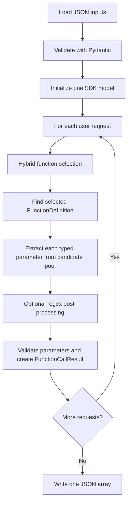
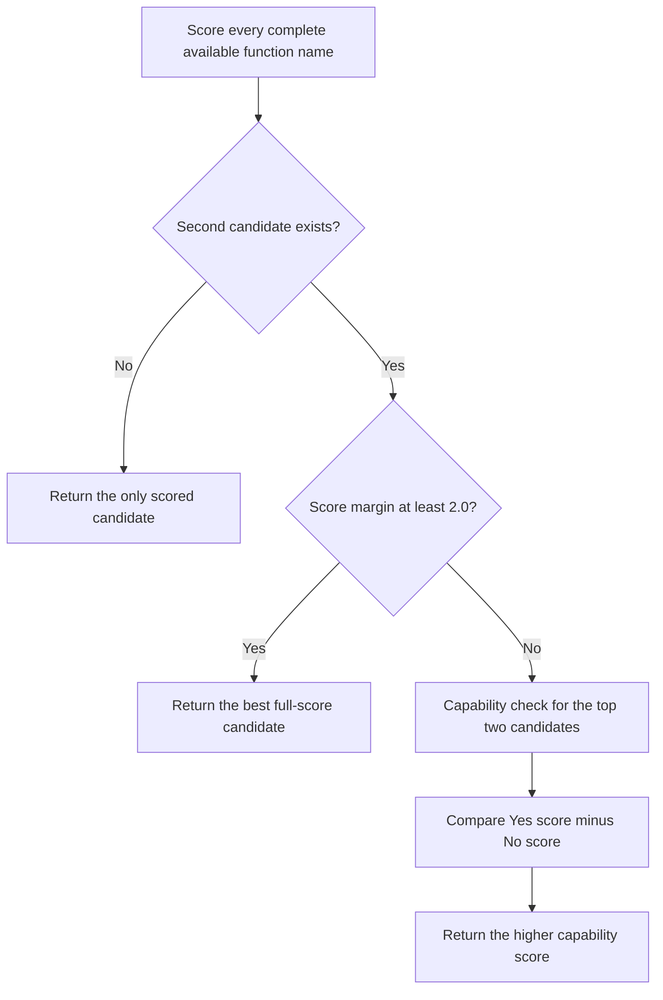

*This project has been created as part of the 42 curriculum by cerkurt.*

# call_me_maybe

A local function-calling tool that translates natural-language requests into
function names and typed arguments using a small language model and
token-by-token constrained decoding.

## Contents

- [Description](#description)
- [Instructions](#instructions)
- [Input and output formats](#input-and-output-formats)
- [Project structure](#project-structure)
- [Architecture diagram](#architecture-diagram)
- [Algorithm explanation](#algorithm-explanation)
- [Design decisions](#design-decisions)
- [Challenges encountered](#challenges-encountered)
- [Testing strategy](#testing-strategy)
- [Performance analysis](#performance-analysis)
- [Current limitations and remaining work](#current-limitations-and-remaining-work)
- [Resources and AI usage](#resources-and-ai-usage)

## Description

Given a request such as `What is the sum of 40 and 2?`, the program identifies
the appropriate function and extracts its input arguments. The result is a
structured call:

```json
[
    {
        "prompt": "What is the sum of 40 and 2?",
        "name": "fn_add_numbers",
        "parameters": {
            "a": 40.0,
            "b": 2.0
        }
    }
]
```

The output describes the call; the application does not execute the selected
function or calculate its return value.

Function definitions are supplied through JSON files. Their names,
descriptions, parameter names, and declared types drive the selection and
validation process. The current supported parameter and return type
declarations are `number`, `string`, and `boolean`.

The supplied `Small_LLM_Model` SDK loads `Qwen/Qwen3-0.6B` by default.
The application uses its public encoding, decoding, and logit methods.
During argument extraction and regex option selection, invalid candidate
continuations are masked before the next token is selected. Function-name
selection instead scores complete available names and may rerank the two
leaders with a separate capability prompt.

**Current documentation snapshot — The implementation uses hybrid 
full-sequence/capability scoring for function selection and finite-candidate,
token-level constrained decoding for argument extraction. See 
[Testing strategy](#testing-strategy) for exact results and limitations.


## Instructions

### Requirements and installation

- Python **3.10+**, as specified by `pyproject.toml` and the subject.
- [uv](https://docs.astral.sh/uv/getting-started/installation/).
- The supplied `llm_sdk/` workspace package.
- Internet access for first-time dependency and model downloads; cached model files
  are reused in later runs.

Install the workspace dependencies from the repository root:

```bash
uv sync
```

The current writer creates missing parent directories automatically with
`Path(path).parent.mkdir(parents=True, exist_ok=True)`. `data/output/` is generated 
locally and must not be included in the submitted repository.

### Run the provided 11-prompt input (standard CLI)

```bash
uv run python -m src
```

Equivalent explicit form:

```bash
uv run python -m src \
  --functions_definition data/input/functions_definition.json \
  --input data/input/function_calling_tests.json \
  --output data/output/function_calling_results.json
```

The standard command processes the whole list and writes **one JSON array**.
A processing error stops that batch rather than automatically skipping the prompt.

### Run one custom prompt immediately

Prepare a one-request JSON list, using the existing default function definitions:

```bash
printf '[{"prompt":"What is the sum of 40 and 2?"}]\n' > /tmp/cmm_one_prompt.json

uv run python -m src \
  --functions_definition data/input/functions_definition.json \
  --input /tmp/cmm_one_prompt.json \
  --output data/output/one_prompt_result.json

uv run python -m json.tool data/output/one_prompt_result.json
```

You can replace the text in `/tmp/cmm_one_prompt.json` with another request;
keep the `[{"prompt": "..."}]` input structure. Escape quotes appropriately.

### Run tests using different function definitions

The CLI does not depend on hardcoded function names. It accepts function definitions,
prompts, and output paths independently:

```bash
uv run python -m src \
  --functions_definition path/to/functions.json \
  --input path/to/prompts.json \
  --output data/output/custom_results.json
```

The normal CLI stops the batch on a processing error. It does not continue
past a failed request, unlike the historical per-request diagnostic runner.
The combined CLI command can therefore stop without writing a new file.
These parent-directory fixtures are not available in a fresh clone unless
supplied separately; the default `data/input/` files are the portable example.

### CLI help and inspection

```bash
uv run python -m src --help
uv run python -m json.tool data/output/function_calling_results.json
```

### Error handling

Malformed JSON, missing files, Pydantic validation failures, unsupported parameter
types, exhausted generation, and output-writing errors are reported at the CLI
boundary. Handled errors return a nonzero status and a descriptive message.

Input validation also rejects empty function definition lists and duplicate function
names. An empty prompt **list** is allowed; a prompt
containing an empty **string** is distinct from an empty list.

The constrained decoder prevents out-of-candidate continuations, but it cannot
guarantee that the model will choose the semantically correct candidate.

### Code-quality checks

The subject's mandatory `lint` check includes flake8 and all of these mypy flags:

```bash
uv run --with flake8 flake8 .
uv run mypy . \
  --warn-return-any \
  --warn-unused-ignores \
  --ignore-missing-imports \
  --disallow-untyped-defs \
  --check-untyped-defs
```

The included Makefile provides `make install`, `make run`, `make debug`,
`make clean`, and `make lint`. `make run` also prints elapsed time through
`/usr/bin/time -p`. The optional `make lint-strict` runs mypy with `--strict`.

## Input and output formats

### Function definitions

The definitions file contains a JSON array. Each item describes one function:

```json
[
    {
        "name": "fn_add_numbers",
        "description": "Add two numbers together and return their sum.",
        "parameters": {
            "a": {
                "type": "number"
            },
            "b": {
                "type": "number"
            }
        },
        "returns": {
            "type": "number"
        }
    }
]
```

A declared return type describes the available function. It is not a result
the application needs to compute.

Pydantic converts these dictionaries into `FunctionDefinition` objects
containing nested `ParameterDefinition` and `ReturnDefinition` objects.

### Prompt tests

The prompts file contains an array of requests:

```json
[
    {
        "prompt": "What is the sum of 40 and 2?"
    }
]
```

Each item is validated as a `PromptTest`.

### Results

Each request produces one `FunctionCallResult` with exactly these output
fields:

| Field | Meaning |
|---|---|
| `prompt` | The original request text. |
| `name` | The selected function name. |
| `parameters` | The complete dictionary of extracted argument values. |

### JSON value types

Parameter types are declared as `"number"`, `"string"`, or `"boolean"` in the 
function definitions. However, the generated output contains actual JSON values, 
not their type names.

For example:

```json
[
    {
        "prompt": "Set the temperature to 18 degrees for room 'office'.",
        "name": "set_temperature",
        "parameters": {
            "room": "office",
            "degrees": 18.0
        }
    },
    {
        "prompt": "Disable notifications for room 'kitchen'.",
        "name": "set_notifications",
        "parameters": {
            "room": "kitchen",
            "enabled": false
        }
    }
]
```

In the output:

- `"office"` and `"kitchen"` are JSON strings.
- `18.0` is a JSON number, not a quoted string.
- `false` is a JSON boolean, not the string `"false"`.

The numeric extractor converts matching numeric text into Python float values. 
For example, the number 18 in the user's request becomes 18.0 in the generated 
JSON output. Both integer and floating-point JSON numbers are valid for 
parameters declared as "number".

## Project structure

The repository separates application responsibilities into these modules:

```text
.
├── src/
│   ├── __init__.py             # Package description
│   ├── __main__.py             # CLI paths, model initialization, errors
│   ├── data_io.py              # JSON loading, model validation, writing
│   ├── data_models.py          # Schemas and final argument-key/type checks
│   ├── generation_flow.py      # Per-request selection/extraction pipeline
│   ├── function_selectors.py   # Name ranking and capability reranking
│   ├── parameter_extractors.py # String/number pools and argument prompts
│   ├── llm_helpers.py          # Chat formatting, token masks, name scores
│   └──regex_helpers.py         # Pattern options and replacement conversion
├── data/
│   ├── input/                  # Default demonstration definitions/prompts
│   └── output/                 # Generated locally; exclude from submission
├── llm_sdk/                    # Supplied uv workspace dependency
├── pyproject.toml
├── uv.lock
├── Makefile
├── .flake8
├── .gitignore
├── call_me_maybe_v1_5.pdf
└── README.md
```

`__main__.py` calls `generation_flow.progress_builder()`. The flow module
uses the selector, extractor, regex, and shared LLM helpers.

## Architecture diagram

An external diagram is available on
[FigJam](https://www.figma.com/board/3LcRyYZk3coNHkmvc3bKv7/call_me_maybe_codam_cerkurt?node-id=0-1&p=f&t=P96hPD09sWdrDlUF-0).

The shortened version of the same Mermaid diagram from the FigJam file 
describes the source-code flow visually.

## Algorithm explanation

### End-to-end overview



`progress_builder()` orchestrates the requests. It does not execute
functions; it produces descriptions of calls. It reuses the same
`Small_LLM_Model` instance across requests.

### 1. Select the function: full scoring inside the hybrid selector

**Full scoring and hybrid selection are connected stages of one selector,
not two independent modes selected by a CLI flag.** For every request,
`generation_flow.progress_builder()` calls
`function_selectors.hybrid_function_selector()`. That function first ranks
every available function by a full-sequence score. Only a close result
triggers the additional capability comparison.

`build_function_selector_prompt()` includes the actual request and the
supplied function names, descriptions, and parameter names/types. System
and user chat messages are followed by the open assistant prefix:

```text
<|im_start|>assistant
<think>

</think>

```

#### A. Full scoring: compare each complete function name

`llm_helpers.score_function_candidate()` evaluates a **known continuation**.
It encodes one function name and scores all its tokens in order. At each
step it obtains logits, converts the specified token's score into a log
probability, then appends that specified token to the context to score
the next one. It does not select the highest-logit token at that step.
The prompt context is reset before evaluating the next candidate name.

```text
name_score = sum of log P(token_i | prompt and earlier name tokens)
```

The code computes the normalization with a stable log-sum-exp calculation:
it subtracts the largest logit before exponentiation. The final score is
a sum of conditional log-probabilities, not a percentage. A larger score
is better; for example, -1.2 ranks above -4.6. Scores are not divided by
the number of tokens, so candidate-name length can affect ranking.

Why compare complete names? The earlier greedy decoder committed to the
strongest allowed next token before evaluating the rest of each possible
name. A locally preferred token does not necessarily begin the strongest
complete continuation. Consider these **invented** scores after a shared
prefix, with two tokens left in each candidate:

| Candidate | First differing token | Following token | Total |
|---|---:|---:|---:|
| A | -0.6 | -4.0 | -4.6 |
| B | -1.0 | -0.2 | -1.2 |

Greedy selection would take A's first differing token because -0.6 is
higher than -1.0. Full scoring evaluates both complete continuations and
prefers B. This gives every supplied name a complete evaluation without
allowing an invented name. It is a different selection criterion, not a
guarantee that the model's preferred name has the right meaning.

#### B. Hybrid selection: use an extra check when the leaders are close

The selector retains the best and second-best full scores and calculates:

```text
margin = best_score - second_score
```



A gap of at least **2.0** returns the full-score leader directly. A smaller
gap runs `capability_score()` for each of the top two definitions. This
helper prepares a separate prompt asking whether that one function can
fulfill the request using suitable arguments. It includes the function's
description and parameter declarations. The same SDK model then scores
the fixed answers `Yes` and `No`:

```text
capability = full_score(Yes) - full_score(No)
```

The code scores **both** answers; it does not need to freely generate a
Yes/No explanation. The larger difference wins. If capability scores
tie, the original full-score leader wins. The original leader is also
returned when it is the only candidate after scoring.

For an **illustrative** example, full scores -2.1 and -2.8 have a margin
of 0.7, which triggers the extra check. If the capability differences
are 0.2 and 3.0 respectively, the second candidate replaces the original
leader. With scores -1.0 and -4.0, the margin is 3.0 and no extra check runs.
These numbers explain control flow; they are not measured test outputs.

#### Why the extra stage was introduced, and what it costs?

The additional question separates two judgments: how likely the function's
name is as a continuation of the selection prompt, and whether that
function's described capability fits the request. Requests involving
negation or overlapping capabilities exposed wrong name selections during
development. A capability prompt gives close candidates another comparison
based on one definition at a time rather than the entire displayed list.
It uses the same model, not a second model or an independent correctness
oracle.

The margin rule limits the cost of this second comparison. Close requests
require four extra continuation scores: Yes and No for each of two
functions. Each score can require multiple SDK logit calls. All function
names are already scored before the margin check, so this approach does
more work than one greedy name continuation.

This design provides a complete-name comparison and a bounded opportunity
to revise an ambiguous ranking. The recorded hybrid tests show its actual
successes and failures, but there is no controlled full-score-only versus
hybrid benchmark here proving how much accuracy the extra stage adds.

The **2.0** threshold is a score-difference heuristic. It can skip a useful 
capability check, and only the top two names are reconsidered. In the extra 
tests diagnostic, the correct function ranked fifth, and the first two names 
were separated by 2.2146, so the normal hybrid path did not reconsider
the correct function. These limits are retained rather than changing the
algorithm during documentation review.

#### Relation to constrained argument decoding

Function selection returns a name from the supplied definitions by scoring
fixed names and, when needed, capability answers. After that, argument
values and regex option codes use `generate_name_from_candidates()` with
token-prefix constraints and logit masking.

### 2. Determine parameter extraction strategy

After matching the selected name back to its `FunctionDefinition`, the
pipeline recognizes a regex-specialized schema **once per selected
function** and creates a new parameter dictionary.

For every declared parameter, it either skips the special `regex` field
(to be generated later), or selects an extraction strategy by its type:

| Declared type | Candidate construction |
|---|---|
| `number` | Extract signed integers, decimals (including `.5`), scientific notation (`1e3`) and comma-grouped forms (`1,000`), then convert to finite floats. |
| `string` | Collect quoted contents, individual chunks, two- and three-word segments outside recognized quotes, and chunks with trailing .!? removed. Deduplicate in first-seen order. Do not append the full request as a fallback. |
| `boolean` | Offer the fixed candidate set `[True, False]`. |

If a number parameter has **no numerical candidates**, a descriptive
`ValueError` is raised rather than fabricating a value. For strings,
both candidate coverage and the model's semantic selection remain
possible sources of error.

`message_for_parameter_extraction()` constructs the LLM prompt using:
the original request, selected function and description, parameter
names/types, **the current parameter**, and values already extracted.
Earlier values help provide context for subsequent parameters, but do
not prevent the same valid value from being used more than once.

### 3. Prepare candidates and run constrained token decoding

Each candidate is serialized using `json.dumps()` and encoded into a
token-ID sequence with the SDK's `encode()` method. The implementation
prepends a space before the serialized candidate, matching the open JSON
prefix of the parameter prompt. Tokenization is sensitive to whitespace
and position: `encode(prefix) + encode(value)` is not necessarily the
same token sequence as `encode(prefix + value)`.

`generate_name_from_candidates()` uses the token sequences to constrain
greedy selection, rather than random sampling. At every generation step:

1. `find_allowed_next_token_ids()` identifies the next token IDs for
   every candidate still matching the generated prefix.
2. `get_logits_from_input_ids()` obtains next-token scores from the
   model, conditioned on the prompt plus previously generated tokens.
3. `select_next_token_id()` masks every disallowed logit to `-inf`,
   without changing token indexes, and selects the strongest allowed ID.
4. The generated ID extends both the full model context and the
   candidate-matching prefix. Generation stops at a complete candidate
   or raises an error when no continuation is possible / the limit is
   exhausted.

For illustration, imagine that two candidate values are encoded as:

```text
candidate_a → [10, 20]
candidate_b → [10, 30]
```

| Already generated | Allowed next tokens |
|---|---|
| `[]` | `{10}` |
| `[10]` | `{20, 30}` |
| `[10, 20]` | Completed `candidate_a` |

The selected candidate is returned as JSON text and converted to the
corresponding Python value with `json.loads()`. It is stored under the
current parameter name in `parameter_dict`. The cycle repeats until all
ordinary parameters have been visited.

A constrained output is **guaranteed to be selected from the supplied
candidates when generation succeeds**, but it is not guaranteed to be
the semantically correct choice.

### 4. Complete regex parameters when recognized

A function activates regex-specific processing only when its definition
contains `source_string`, `regex`, and `replacement`, **all declared as
strings**. Detection depends on the parameter schema, not the function
name.

The `regex` field is skipped during the ordinary extraction loop; the
other parameters are extracted first. After the loop:

1. `convert_regex_replacement_value()` can normalize certain unquoted
   character names (for example, `asterisks` becomes `*`).
2. `regex_candidate_generator()` provides seven category patterns —
   vowels, letters, digit sequences, uppercase, lowercase, whitespace,
   punctuation — plus eligible request-derived quoted literals.
3. `generate_regex_pattern()` maps these to short option labels and
   uses constrained token selection to choose the best one.
4. The selected option is translated back to a regex pattern and stored
   in `parameter_dict["regex"]`.

Examples include `[aeiouAEIOU]` for vowels and `[0-9]+` for digit
sequences. This is **bounded pattern selection**, not arbitrary regex
synthesis. The application does not call `re.sub()` as part of function
execution; replacement examples were verified separately in tests.

### 5. Validate and write the structured result

`parameter_type_checker()` confirms that all required parameter names are
present, no unexpected names were added, and values match their declared
types. The numeric check accepts `int` values and finite `float` values but rejects
`bool`, which Python otherwise considers a subclass of `int`.

Successful requests yield one `FunctionCallResult` each, with precisely
`prompt`, `name`, and `parameters`. After the request loop completes,
`model_dump()` provides Python dictionaries, and
`json.dumps(..., allow_nan=False)` serializes the array to UTF-8 JSON.

Pydantic and the final parameter checker validate **structure and types**.
They cannot prove that a chosen function or argument corresponds to the
user's intended meaning. This is why semantic comparisons against expected
calls are included in the test strategy.

## Design decisions

- **Separate I/O, data models, generation, and orchestration.** Loading a file
  and selecting a model continuation have different responsibilities.
  Reusable functions receive paths, validated objects, or an existing SDK
  model as appropriate.
- **Reuse one model instance.** Model loading happens once after the input
  files have been validated.
- **Read function metadata from the supplied definitions.** The application reads
- function names, descriptions, and parameter types from the provided JSON file
- instead of hardcoding rules for individual functions. This allows the same
- selection pipeline to work with new function definitions without modifying the
- Python code.
- **Use explicit candidate constraints.** Prompt wording provides context;
  the logit mask restricts which candidate continuations can be selected.
- **Retain extraction context.** Previously extracted parameters accompany
  the current parameter request.
- **Share prompt assembly across parameter types.** A type-specific system
  instruction is selected inside one builder, while function metadata,
  previous values, chat roles, and the open JSON prefix use one structure.
- **Expand the pool before constraining selection.** Word n-grams make
  multiword values available without assuming every quoted phrase is the
  desired argument. The token mask then restricts selection to that pool.
- **Accumulate one complete result per request.** Parameter dictionaries
  are initialized outside the inner parameter loop.
- **Report errors at the CLI boundary.** Lower-level loading and validation
  functions propagate errors; handled failures terminate the command.

## Challenges encountered

### Whitespace changes token boundaries and model scores

A leading or trailing space is part of the token sequence. During development,
moving a space between the JSON prefix and the value candidate changed the
IDs presented to the model and the allowed next-token choices.

For example, the following were measured through the SDK tokenizer:

| Text supplied to `encode()` | IDs |
|---|---|
| A single space | `[220]` |
| A double quote | `[1]` |
| A space followed by a double quote | `[330]` |
| `"cat"` | `[1, 4616, 1]` |
| A space followed by `"cat"` | `[330, 4616, 1]` |
| `"cat"` followed by a space | `[1, 4616, 1, 220]` |
| A minus sign | `[12]` |
| A space followed by a minus sign | `[481]` |

These IDs describe the inspected tokenizer, not a universal vocabulary.

Consider two ways to construct the same visible boundary:

```text
A: encode(prefix ending in ": ") + encode("\"cat\"")
B: encode(prefix ending in ":")  + encode(" \"cat\"")
```

The concatenated text can look identical while the concatenated token-ID
lists differ. In general:

```text
encode(prefix) + encode(value) != encode(prefix + value)
```

In case A, a separate space and quote can produce IDs `220` and `1`.
In case B, the combined space-plus-quote token can be `330`.
The model is then evaluating different token continuations at different
positions, so the logits are not directly interchangeable.

Trailing whitespace cannot retroactively change logits that have already
been computed. It can affect tokenization at a boundary, the allowed
continuations, or when a candidate is considered complete. Investigating
a changed answer requires the exact prompt and candidate token sequences.

Whitespace also has a data-level meaning:

| JSON text | Decoded value |
|---|---|
| `"cat"` | Three characters: `cat` |
| `"cat" ` | The same three-character value; the space is outside the string. |
| `"cat "` | Four characters; the final space belongs to the argument. |

The current argument path ends the JSON prefix at the colon and puts the
space at the beginning of the serialized candidate. This convention improved
the tested boundaries together with the fuller argument context. It is not
a universal rule that adding a space produces the correct semantic answer.

### A correct value must be present in the candidate pool

One request exposed a candidate-extraction error:

```text
Set the temperature to 18 degrees for room 'office'.
```

The outside-quotes splitter retained `'office'.`. Its final character was
a period, so the condition that removed matching outer quotes did not apply.
The plain `office` value was absent from the pool, making it unavailable
to constrained selection.

The inside-quotes helper already found `office`. Its results were added
to the candidate pool for multi-parameter functions, which fixed the
temperature example.

This led to a useful debugging order: inspect candidate construction before
changing the model prompt.

### Multiword values needed both a larger pool and clearer instructions

An earlier pool could offer only separate words for an unquoted full name.
For `Greet Jane Doe`, selecting either `Jane` or `Doe` loses part of
the requested value. Adding contiguous two- and three-word phrases makes
`Jane Doe` available without manually encoding a specific person's name.

Pool construction and prompting solve different parts of this problem.
The shared builder's string instruction asks for the complete current
argument and distinguishes it from the command. In
`Greet Jane Doe using the word 'hello'`, both the name and the quoted
word remain candidates; the function description and parameter name must
guide the model to the name. Extended tests correctly extracted all nine 
greet examples and six echo examples, including an unquoted three-word 
value, an empty string, and Unicode.

The current implementation deduplicates words, phrases, quoted spans,
and punctuation-trimmed chunks. Unlike that earlier version, it does not
append the entire request as a fallback. It does not enumerate every possible
substring. A targeted pool check still finds no
`First Second Third Fourth` candidate for the longer command
`Greet First Second Third Fourth`.

### Valid JSON regexes could still match the wrong characters

The experimental free-string path could produce a complete JSON string
whose content was the wrong regex. For example, `[a-zA-Z]+` is a valid
pattern but replaces whole letter sequences when the request asks only
for vowels. Testing only `json.loads()` would miss that error.

Extended checks therefore applied the selected pattern to source text:

| Source | Pattern | Replacement | Expected diagnostic result |
|---|---|---|---|
| `Room 12` | `[0-9]+` | `X` | `Room X` |
| `Programming is fun` | `[aeiouAEIOU]` | `*` | `Pr*gr*mm*ng *s f*n` |
| `The cat sat on the mat with another cat` | `cat` | `dog` | `The dog sat on the mat with another dog` |

Selecting short option codes from a described pattern catalog gave a
usable bounded path. The code, descriptive label, regex text, and encoded
token sequence have separate roles. Encoding the option codes constrains
the model's answer to the displayed choices; mapping back supplies the
actual pattern. Prompt wording still affects which allowed option wins.
The catalog is therefore documented as limited support, rather than a
guarantee of arbitrary regex generation.

The literal replacement `asterisks` exposed a separate issue: even the
correct vowel pattern inserts that word repeatedly unless the requested
symbol is interpreted as `*`. The small quote-aware character-name helper
addresses the supported cases while preserving quoted literal text.

### Numeric parsing improvements do not guarantee the chosen argument

The old numeric pattern split `.5`, scientific notation, and comma-grouped
numbers incorrectly. The updated extractor offers `0.5`, `1000.0`, and
`1000.0` for `.5`, `1e3`, and `1,000`, respectively.

The numeric extractor preserves signed values, including both `0.5` and `-0.5` 
in requests such as `Add 0.5 and -0.5.`. Previously selected values are not 
excluded from subsequent parameter candidate pools, allowing valid repeated 
arguments such as `Add 7 and 7.`. Earlier tests exposed incorrect numeric 
selection despite correct candidate extraction, but this failure was not 
reproduced in the latest extended test set.

### Quoted text, apostrophes, and escape characters have different roles

`Reverse 'hello world' please` contains one quoted argument with an internal
space. Splitting only on spaces loses that grouping.

There are also multiple interpretation layers:

1. A Python source string may process escape sequences before a function
   receives it.
2. A JSON input file has its own string-escaping rules.
3. A quote in the natural-language request can delimit an argument or be
   part of its content.
4. The output serializer must escape the resulting value correctly.

For example:

```python
actual_newline = "\n"
escaped_newline = "\\n"

assert len(actual_newline) == 1
assert len(escaped_newline) == 2
```

A literal newline inside a JSON string must be escaped. In the string-state
experiments, a backslash followed by the letter `n` is handled differently
from a raw control character. Inspecting `repr(text)` helped make the
difference visible.

The current splitters handle the tested quote forms; escaped delimiters
and more ambiguous natural-language quoting still need broader coverage.

### Schema validity and the intended meaning need different tests

A value can have the correct type and still represent the wrong argument.

During an early `Reverse the string 'hello'` experiment, the next-token
scores after the opening quote were approximately:

| Candidate token | Logit |
|---|---:|
| `string` | 25.0326 |
| `hello` | 25.0196 |

Both were allowed strings. Greedy selection picked `string` by a small
margin. In the corresponding `world` request, `world` scored about 28.3006
and `string` about 26.6283.

Restricting a quoted single-argument request to its quoted candidate helped
those examples, but excluded the actual name in requests such as
`Greet Jane using the word 'hello'`. The current implementation removed
that shortcut, expanded the pool with n-grams, and strengthened the shared
string instruction. Quoted text remains available alongside other values.

The same distinction applies to booleans: `disabled: true` is validly
typed but wrong for a request to enable notifications.

### An extra function exposed weak selection prompting

With only temperature and notification functions, the small test set selected
the expected names. After `echo_text` was added, the plain selection prompt
chose `echo_text` for all nine requests.

Wrapping the same selection content in system and user messages followed
by an open assistant prefix restored correct name selection in a diagnostic
covering nine new requests and eleven original requests. This was a prompt-format 
improvement; the token mask continued to enforce the available name candidates.

### Extracted arguments must remain separate from parameter declarations

The metadata `{"type": "number"}` describes what kind of value a parameter
expects. An extracted value such as `2.0` is a separate piece of data.

Similarly, printing `ParameterDefinition(type='number')` displays a nested
Pydantic object's representation. The object has not become a string field.
Its `.type` attribute accesses the declared type, and `model_dump()` creates
a dictionary representation.

Keeping those layers distinct prevented mistakes such as treating the
parameter dictionary as a single parameter name or replacing a function
definition's metadata with the extracted arguments.

The word "model" also names two different concepts here: Pydantic models
validate structured data, while `Small_LLM_Model` supplies tokenizer
operations and next-token scores. Each function needs the appropriate kind
of object for its responsibility.

### A tuple of messages is not one model-input string

This return value contains three separate strings in a tuple:

```python
return system_message, user_message, open_assistant_start
```

The SDK expects one input string. Passing the tuple during development
produced a tensor-shape error referring to inconsistent sequence lengths.
Concatenating the message strings before returning them fixed the mismatch.

### Unicode escapes can preserve the original text

This JSON representation:

```json
{
    "text": "\u00c7a\u011fr\u0131 \ud83c\udf21\ufe0f"
}
```

decodes to:

```text
Çağrı 🌡️
```

The verified comparison used `json.load()`/`json.loads()` and the actual
decoded value. Python's JSON writer uses ASCII escaping by default.
The current writer uses `ensure_ascii=False` and UTF-8 so literal Unicode
characters remain readable in the file. This changes presentation rather
than the decoded value.
See the [Python JSON documentation](https://docs.python.org/3/library/json.html).

### Exceptions belong at the right boundary

A missing file already raises an error from `open()`. A malformed JSON
document raises a decoding error from `json.load()`. A mismatched Pydantic
field raises a validation error.

A lower-level `except` block that only re-raises the same error adds no
new handling. The CLI provides context and an exit status for handled
failures. Stopping after a failed generation also avoids continuing with
a result variable that was never assigned.

## Testing strategy

Testing checks input loading and Pydantic validation, function-name selection,
number/string/boolean candidate generation, constrained token decoding, semantic
argument accuracy, output schema, edge cases, failure reporting, and end-to-end
CLI behavior. Ground-truth function calls were specified separately from model output.

### Recorded outcomes (November 16–17, 2026)

These are recorded development runs, not fresh inference benchmarks from
this documentation review. The saved default output was checked against
all 11 expected calls. The local combined report was independently
recounted: its actual-versus-expected records confirm 71/76 complete calls,
73/76 correct names, and one error. The full 31-case report is not present
in the current workspace; its 19/31 figure and six errors remain a
historical reported result rather than a newly audited measurement.

| Test set | Available functions | Prompts | Fully correct | Accuracy | What this measures |
|---|---:|---:|---:|---:|---|
| Supplied/default 11-prompt input | Original supplied functions | 11 | 11 | **100%** | Standard CLI, original assignment input |
| Original extended regression set | 8 | 55 | 54 | **98.2%** | Additional prompts and edge cases |
| Independent generalization set | 7 new functions | 31 | 19 | **61.3%** | Unseen function names, overlapping capabilities, harder boolean/string cases |
| Curated combined regression set | 15 | 76 | 71 | **93.4%** | All prior 55 plus 21 selected generalization examples |

The 76-case run reported **73/76 correct function names** and **one execution
error**. The original 55 cases retained **54/55** correct results after adding
the new competing definitions. The 31-prompt independent set used a separate
seven-function definition list; six prompts raised errors and were counted as
failures, not omitted from its 61.3% metric.

**Important:** These are different, manually designed datasets, not directly
comparable estimates of accuracy on unknown evaluation inputs. The combined
set is curated and includes many cases already known to succeed. Its 93.4%
accuracy does not supersede the independent generalization result of 61.3%.

### Failure analysis from the combined 76-case suite

| Case | Observed behavior | Classification |
|---|---|---|
| `OLD-34` | `Greet the person by name and surname: Jane Doe` returned only `Jane` | Incomplete multiword string extraction |
| `NEW-10` | Reminder request could not obtain required `hour` for an incorrectly selected alarm function | Function selection and subsequent missing-candidate error |
| `NEW-16`, `NEW-17` | Discount requests selected regex substitution instead | Candidate-set sensitivity / incorrect function selection |
| `NEW-28` | `unmute it` yielded `muted: true` instead of `false` | Boolean semantic interpretation |

The reminder issue was investigated with full-sequence scores. For `NEW-10`,
`configure_alarm` ranked first at **-0.8778**, while `create_reminder` ranked
fifth at **-10.2577**. The margin between the top two was **2.2146**, above
the **2.0** reranking threshold. Independent capability scoring favored
`create_reminder` (**6.2656**) over `configure_alarm` (**4.0938**), but the
correct function was outside the top-two shortlist and capability reranking
did not run in the normal hybrid path.

In the separate 31-case generalization run, problems also appeared with
apostrophes inside quoted strings, empty-string selection, boolean negation,
and overlapping capabilities (`reminder` versus `alarm`).

Two discount cases passed with seven available functions but selected the wrong
function when the combined list expanded to fifteen. This demonstrates that
adding competing definitions can change semantic function selection even when
the output remains structurally valid.

### Reproducing the mandatory/default test run

```bash
uv run python -m src \
  --functions_definition data/input/functions_definition.json \
  --input data/input/function_calling_tests.json \
  --output data/output/function_calling_results.json
uv run python -m json.tool data/output/function_calling_results.json
```

### Inspecting stored diagnostics and running local fixtures

The local combined report can be inspected without running the model:

```bash
uv run python -m json.tool ../combined_evaluation/combined_run_report.json
```

It records each expected call, observed call or error, and pass flag. This
report is a development artifact outside the repository. The accompanying
runner requires the path and module updates described in Instructions
before it can reproduce the report with the current project layout.

The independent 31-request input can be passed to the standard CLI:

```bash
uv run python -m src \
  --functions_definition ../test_inputs/generalization_functions.json \
  --input ../test_inputs/generalization_prompts.json \
  --output data/output/generalization_results.json
```

This exercises normal fail-fast batch behavior; it is not a command for
reproducing a per-request report that continues after six errors. The old
local `test_generalization.py` also refers to moved input files and a
missing expected-results file, so it needs maintenance before reuse.

### Validation and negative input tests

Explicit bad-input checks passed for malformed JSON, missing required fields,
empty function lists, and duplicate function names. An unsupported parameter
type is rejected by Pydantic. Tests also covered missing numeric argument
candidates, Unicode, quoted/empty strings, scientific notation, negative
numbers, thousands separators, multiple parameters, regex substitution, and
boolean instructions with negation.

For example, deliberately pass an invalid JSON file:

```bash
printf '[{"name":"broken",}]\n' > /tmp/cmm_bad.json
uv run python -m src --functions_definition /tmp/cmm_bad.json
```

This should report a JSON parse error and exit nonzero without starting the model.

## Performance analysis

Previously recorded cached-model timings on the development machine:

The figures below are retained from the author's run record. Raw timing
logs are not bundled in this checkout, and this documentation review did
not run model inference again to remeasure them.

| Workload | End-to-end runtime | Result |
|---|---:|---|
| Default 11-prompt CLI | **46.617 s** | 11/11 fully correct |
| Original 55-prompt CLI | **4 min 13.26 s** | 54/55 fully correct |

The default and 55-prompt measurements were obtained using the real
`Small_LLM_Model` SDK and the regular batch CLI. The combined 76-prompt
regression set was run using a shared-model per-prompt diagnostic runner;
a comparable total runtime for that run was not recorded. Per-prompt
subprocess tests (which reload the model repeatedly) are not a valid
measurement of a single-batch run.

The subject requests 90%+ accuracy, 100% JSON/schema compliance for outputs,
and processing of all evaluation prompts in under five minutes on standard
hardware. The 55-prompt run met the five-minute target on the development
machine, but this does not guarantee the same runtime with different models,
function counts, prompts, or evaluator hardware.

For another local timing measurement:

```bash
time uv run python -m src \
  --functions_definition data/input/functions_definition.json \
  --input data/input/function_calling_tests.json \
  --output data/output/function_calling_results.json
```

The model is initialized once per batch. Repeated SDK logit calculations,
context length, candidate pool size, and token limits affect runtime.
There is a clear trade-off between fuller comparison of alternative
functions and inference time.

## Current limitations and remaining work

1. **Function selection is sensitive to the candidate set.** Full-sequence
   scoring followed by top-two capability reranking can miss a correct
   function ranked outside the shortlist. The reminder/alarm example in
   `NEW-10` demonstrates this. Adding competing functions can also change
   results: `NEW-16` and `NEW-17` passed with seven functions but chose
   regex substitution in the fifteen-function run.
2. **Total log-probability is length-sensitive.** Scores are summed across
   name tokens, which may favor shorter candidate token sequences. This
   may contribute to some rankings, but the specific failures above were
   not proven to be caused by name length.
3. **String candidate coverage and selection are imperfect.** The pool
   supports quoted spans, individual chunks, two- and three-word n-grams,
   and punctuation-trimmed chunks. It does not append the full request
   as a fallback. The correct value can still lose to an incomplete
   candidate (`OLD-34`: `Jane` instead of `Jane Doe`). Ambiguous
   apostrophes, escaped delimiters, and some empty-string instructions
   also remain challenging.
4. **Boolean polarity is not always inferred correctly.** Negated or
   inverse-state commands (`unmute` with `muted`) may yield an incorrect
   boolean even though both `True` and `False` are valid candidates.
5. **Numeric extraction and selection are separate.** Signed, decimal,
   scientific, and comma-grouped numeric forms are supported, but
   written-out numbers and locale-specific representations are not
   generally converted. Missing numerical candidates raise `ValueError`
   instead of inventing a number.
6. **Regex support is deliberately bounded.** Only a recognized schema
   containing string `source_string`, `regex`, and `replacement` activates
   post-processing. Supported patterns come from a small category catalog
   plus certain quoted literals; arbitrary regex synthesis is not provided.
7. **Valid structure does not imply correct meaning.** Pydantic and the
   result checker verify names/types relative to the selected definition,
   but a structurally valid call can select the wrong function or value.
8. **Batch CLI behavior is fail-fast.** A missing required argument can
   stop the normal batch. The optional test runner catches errors per
   request solely to measure the remainder of a regression set.
9. **Final submission verification remains necessary.** The November 17
   review confirmed clean flake8 and the mandatory mypy flags, complete
   module/function/class docstrings, and the required Makefile targets.
   A fresh-clone run still needs its final check. At review time,
   `data/output/function_calling_results.json` was still tracked despite
   the ignore rule; remove generated output from Git's tracked submission.
10. **Optional artifacts are not fully portable yet.** The FigJam PDF/PNG
   exports are absent, while diagnostic fixtures live above the repository
   and their old runners require path/import updates. Default CLI usage
   does not depend on these optional artifacts.

These limitations are documented from observed tests; the reported percentages
are not guarantees for unknown evaluation prompts.

## Resources and AI usage

### References

- [Project subject v1.5](call_me_maybe_v1_5.pdf): mandatory behavior, output
  format, evaluation targets, and README requirements.
- [Supplied SDK source](llm_sdk/llm_sdk/__init__.py): public methods and model
  initialization.
- [Python JSON documentation](https://docs.python.org/3/library/json.html):
  loading, serialization, escaping, and encoder options.
- [RFC 8259](https://www.rfc-editor.org/rfc/rfc8259): JSON syntax, numbers, and
  string representations.
- [Python regular expressions](https://docs.python.org/3/library/re.html):
  candidate-number extraction and escape syntax.
- [Pydantic models](https://docs.pydantic.dev/latest/concepts/models/):
  nested models, validation, and serialization.
- [uv project guide](https://docs.astral.sh/uv/guides/projects/) and
  [additional run dependencies](https://docs.astral.sh/uv/concepts/projects/run/#requesting-additional-dependencies):
  workspace environments and command execution.
- [Qwen3-0.6B model card](https://huggingface.co/Qwen/Qwen3-0.6B):
  model information and chat behavior.
- [Hugging Face chat templates](https://huggingface.co/docs/transformers/main/en/chat_templating):
  message roles and generation prefixes, consulted for understanding the
  prompt format. The application accesses the model through the supplied SDK.
- [Attention Is All You Need](https://arxiv.org/abs/1706.03762):
  background on the Transformer architecture.

### How AI was used

ChatGPT/Codex was used as a **learning, debugging, and documentation partner**
in these areas:

- **Concepts and SDK exploration:** Python collections, Pydantic models,
  logit masking, tokenization boundaries, JSON encoding/decoding, and the
  supplied SDK's public methods.
- **Algorithm design and review:** Discussing finite candidate pools,
  full-sequence log-probability scoring, capability-based reranking,
  sequential argument extraction, and the regex special case.
- **Tests and debugging:** Designing normal and edge-case prompts,
  generating independent expected results, analyzing wrong function
  choices and argument values.
- **Documentation:** Reviewing README completeness against the project
  subject, preparing evaluation-friendly descriptions of trade-offs and
  known limitations.
